# Awesome Robot RSI

Recent papers on robot recursive self-improvement.

[Website](https://Bailey-24.github.io/awesome-robot-RSI/) · [Contributing](CONTRIBUTING.md)

## Papers

### R²SI: Recursive Robot Self-Improvement via a Bi-Level Agentic System with Agent–Model Co-Evolution

**Report released:** 2026-10-24

Technical report date; the project was announced on 2026-10-17.

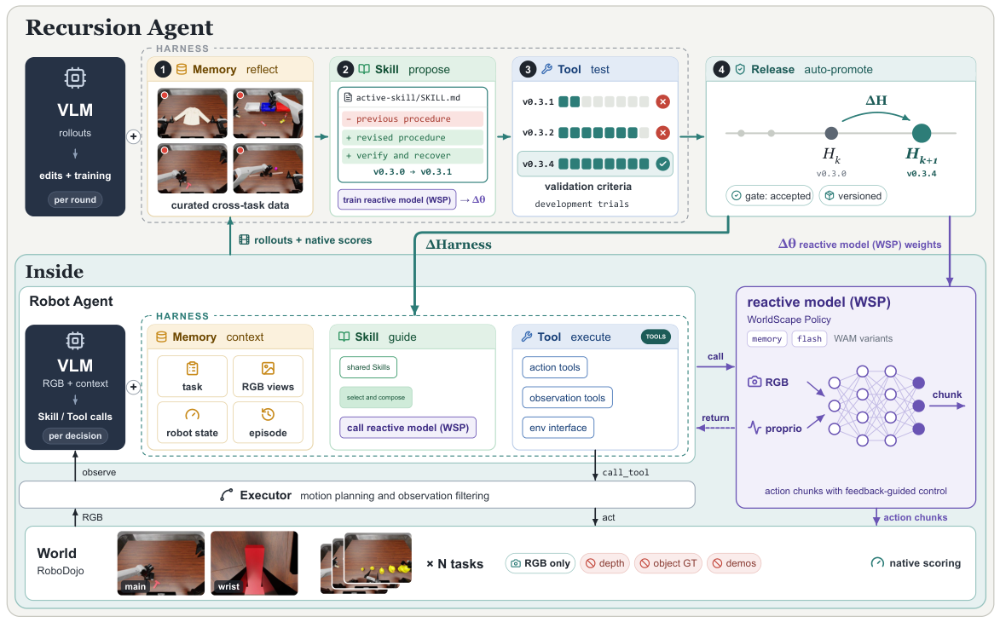

*Manifold AI Team, R²SI technical report, Figure 1. [Figure source](https://r2si.worldscape.io/report.pdf#page=2).*

Uses a Robot Agent to execute tasks and a Recursion Agent to improve reusable skills and train the reactive model from rollout feedback.

[Paper](https://r2si.worldscape.io/report.pdf)

[Models](https://huggingface.co/manifoldai-research/WorldScape-R2SI) · [Project](https://r2si.worldscape.io/)

### From VLM Planners to Robotic Agents: Self-Evolving Harnesses for History-Dependent Manipulation

**First release:** 2026-10-21

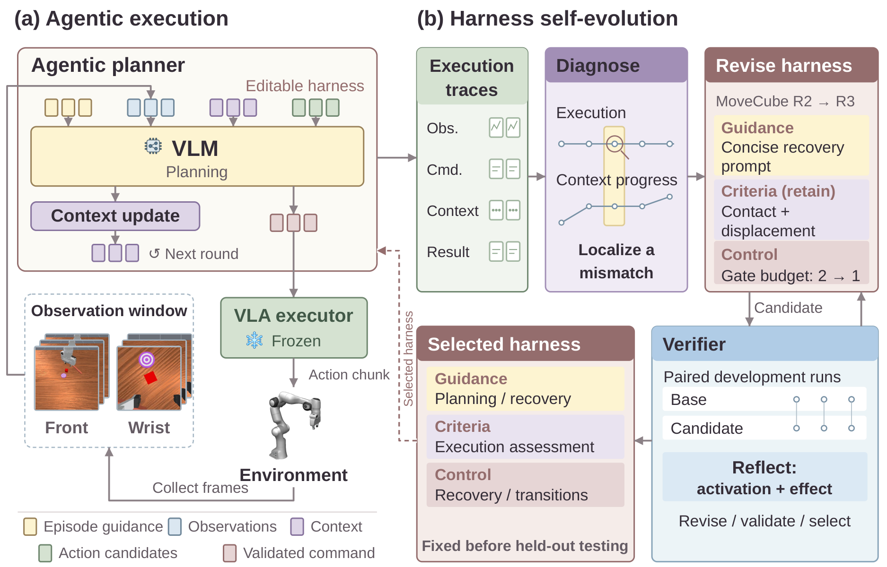

*Tingwen Du et al., From VLM Planners to Robotic Agents: Self-Evolving Harnesses for History-Dependent Manipulation. Core method figure from the official paper/project. [Figure source](https://stevenkkxs.github.io/sera-webpage/).*

Improves a planning harness from robot rollouts while keeping the low-level VLA fixed, helping the agent track task history and recover from failures.

[Paper](https://arxiv.org/abs/2610.29560) · [Code](https://github.com/StevenKKXS/SERA)

[Project](https://stevenkkxs.github.io/sera-webpage/)

### Where is Physical RSI capability from? An Observational Scaling Law of LLM-as-policy

**First release:** 2026-10-19

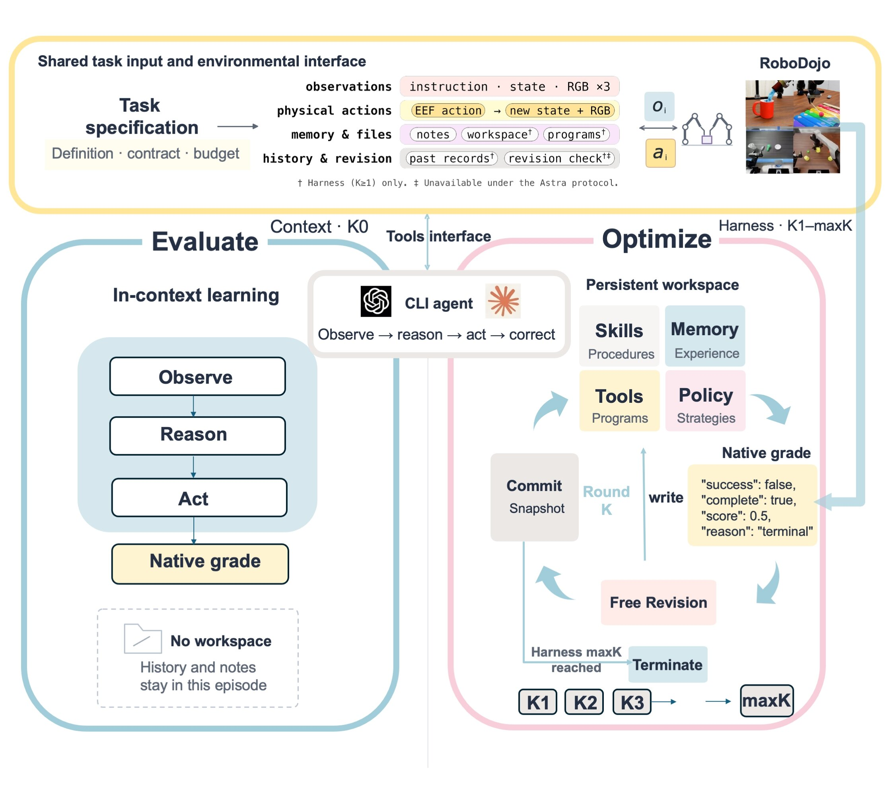

*Zekai Li et al., Where is Physical RSI capability from? An Observational Scaling Law of LLM-as-policy. Core method figure from the official paper/project. [Figure source](https://physrsi-eval.github.io/).*

Evaluates how robot agents improve across repeated attempts, measuring learning speed, interaction cost, and generalization.

[Paper](https://arxiv.org/abs/2610.26848) · [Code](https://github.com/PhysRSI-Eval/PhysRSI-Eval-code)

[Project](https://physrsi-eval.github.io/)

### HexaShell: A Thin Harness for Exploring the Limits of VLM Agents as Robot Coding Agents

**First release:** 2026-10-16

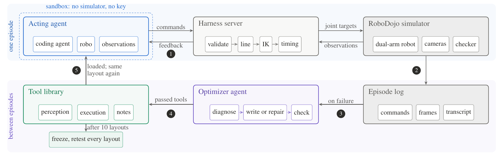

*Hongcheng Gao, Alex Zhou et al., HexaShell, Figure 4; official HexaFuture project page. [Figure source](https://hexafuture.ai/blog/hexashell/assets/fig04-harness-20261020.webp).*

Pairs a robot coding agent with an optimizer that diagnoses failed episodes and repairs reusable tools for future tasks.

[Paper](https://arxiv.org/abs/2610.23479) · [Code](https://github.com/HexaFuture/HexaShell)

[Project](https://hexafuture.ai/blog/hexashell/)

### EmbodiedEvo: Self-Evolving Coding Agent For Physical Intelligence

**First release:** 2026-10-13

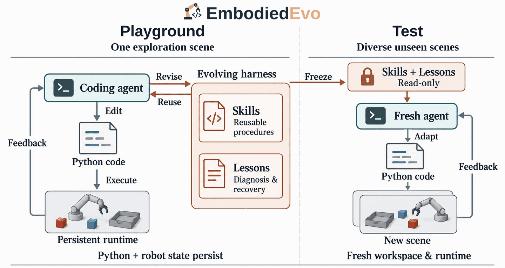

*Wenyi Li et al., EmbodiedEvo: Self-Evolving Coding Agent For Physical Intelligence. Core method figure from the official paper/project. [Figure source](https://lab.einsia.ai/embodiedevo/).*

Learns reusable code skills and diagnostic lessons in a practice scene, then transfers them to new scenes without updating model weights.

[Paper](https://arxiv.org/abs/2610.18867) · [Code](https://github.com/Einsia/EmbodiedEvo)

[Project](https://lab.einsia.ai/embodiedevo/)

### SEAR: Self-Evolving Agentic Robotics

**First release:** 2026-10-13

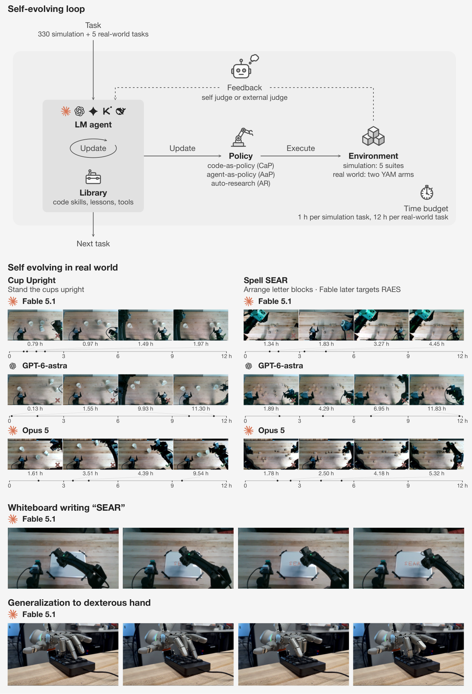

*Xinyi Wang et al., SEAR: Self-Evolving Agentic Robotics. Core method figure from the official paper/project. [Figure source](https://arxiv.org/html/2610.18792v1#S1.F2).*

Studies whether robot agents retain useful skills and memories, and whether those improvements transfer across tasks, simulators, and real robots.

[Paper](https://arxiv.org/abs/2610.18792)

[Project](https://sear.bot/)

### RSI-Nav: Data-Centric Recursive Self-Improvement for Navigation via Policy-Synchronized Language-Action Dual Bootstrapping

**First release:** 2026-10-11

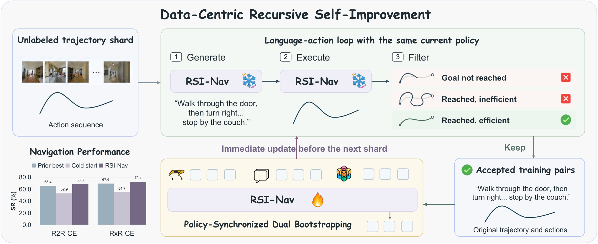

*Songze Li et al., RSI-Nav: Data-Centric Recursive Self-Improvement for Navigation via Policy-Synchronized Language-Action Dual Bootstrapping. Core method figure from the official paper/project. [Figure source](https://arxiv.org/html/2610.15782v1#S3.F3).*

Bootstraps navigation by generating instructions, filtering them through execution, and repeatedly updating the policy with the resulting data.

[Paper](https://arxiv.org/abs/2610.15782) · [Code](https://github.com/OpenGVLab/RSI-Nav)

### Embodied Turing Machines: Stateful Code for Robot Recursive Self-Improvement

**First release:** 2026-10-08

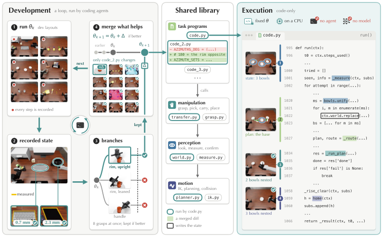

*Kairui Hu et al., Embodied Turing Machines: Stateful Code for Robot Recursive Self-Improvement. Core method figure from the official paper/project. [Figure source](https://arxiv.org/html/2610.12369v1#S3.F3).*

Builds a shared stateful code library through execution feedback, then runs robot tasks directly from code without model inference at test time.

[Paper](https://arxiv.org/abs/2610.12369)

### EmbodiedRSI: Active Continual Robot Learning Through Hypothesis-Guided Co-Evolution

**First release:** 2026-10-07

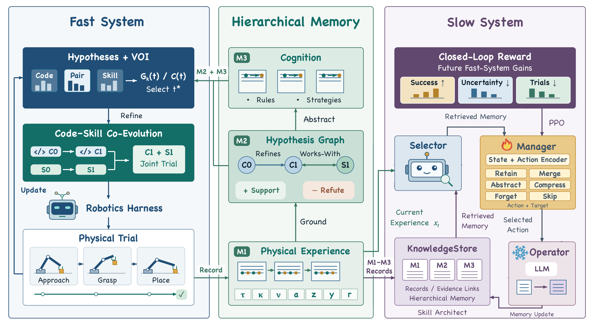

*Python Song et al. (2026), EMBODIEDRSI method overview. [Figure source](https://geeksongs.github.io/agentic_robotics/).*

Selects informative robot experiments to test hypotheses and improve executable code, reusable skills, and memory.

[Paper](https://arxiv.org/abs/2610.10498)

[Project](https://geeksongs.github.io/agentic_robotics/)

### Reconstruct, Practice, Go Real: Guided Self-Improvement for Embodied Agents

**First release:** 2026-10-01

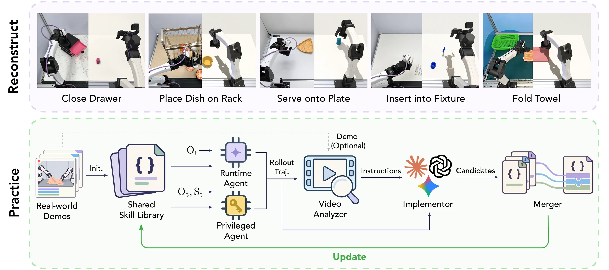

*Yen-Jen Wang et al., Reconstruct, Practice, Go Real: Guided Self-Improvement for Embodied Agents. Core method figure from the official paper/project. [Figure source](https://rpg-robot.github.io/).*

Reconstructs tasks in simulation, improves a shared skill library through practice and failure diagnosis, and transfers it to physical robots.

[Paper](https://arxiv.org/abs/2610.02204)

[Project](https://rpg-robot.github.io/)

### Fewer Tokens, Better Action: GPT-6 Astra Robot Agents with 14% Higher Success Rate but 65% Fewer Tokens

**First release:** 2026-10-01

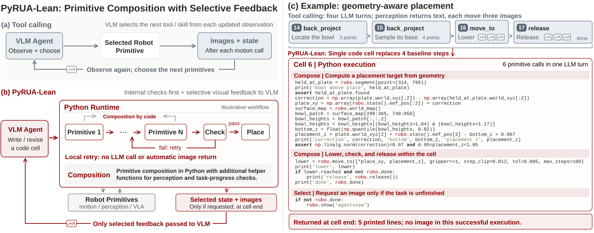

*Ruiyang Si, Jianxin Bi et al., PyRUA-Lean, Figure 2. [Figure source](https://arxiv.org/html/2610.01939v1/method_red.svg).*

Reduces model calls and redundant observations by letting robot agents compose actions and handle checks and retries in an interactive Python runtime.

[Paper](https://arxiv.org/abs/2610.01939) · [Code](https://github.com/DAGroup-PKU/PyRUA-Lean)

[Models](https://huggingface.co/DAGroup-PKU/PyRUA-Lean-Coder-v0.1-4B) · [Project](https://dagroup-pku.github.io/PyRUA-Lean/)

### RoboHarn-Evo: Evolving Hierarchical Physical Knowledge for Self-Improving Robotic Manipulation

**First release:** 2026-09-29

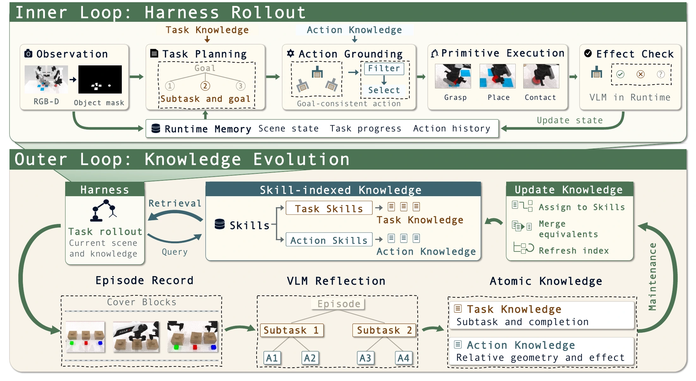

*Shifeng Bao et al., RoboHarn-Evo: Evolving Hierarchical Physical Knowledge for Self-Improving Robotic Manipulation. Core method figure from the official paper/project. [Figure source](https://ruckbreasoning.github.io/RoboHarn-Evo/).*

Uses execution feedback to revise hierarchical task and action knowledge while keeping the base model and executor fixed.

[Paper](https://arxiv.org/abs/2609.37583) · [Code](https://github.com/RUCKBReasoning/RoboHarn-Evo)

[Project](https://ruckbreasoning.github.io/RoboHarn-Evo/)

### Recursive Harness Distillation across Agents for Robot Manipulation

**First release:** 2026-09-27

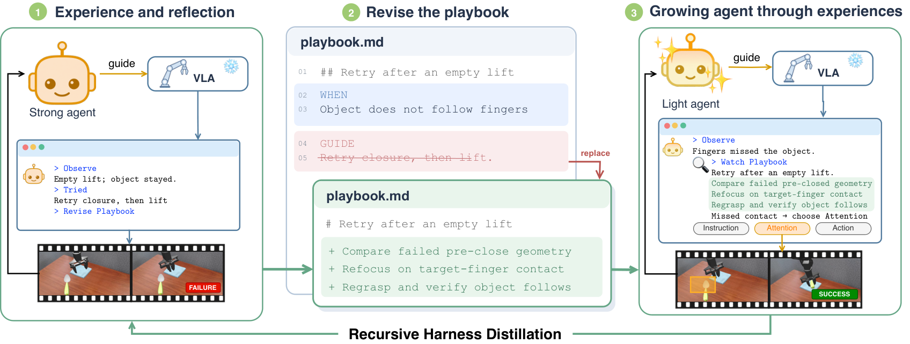

*Seungyeon Kim et al., Recursive Harness Distillation across Agents for Robot Manipulation. Core method figure from the official paper/project. [Figure source](https://seungyeon.me/RHD/).*

Distills a strong agent’s robot experience into a playbook for a lighter agent, then refines the playbook using the recipient’s feedback.

[Paper](https://arxiv.org/abs/2609.33378)

[Project](https://seungyeon.me/RHD)

### Zetta ζ: An Efficient Closed-Loop Embodied Harness for Self-Evolving Physical Intelligence

**First release:** 2026-08-17

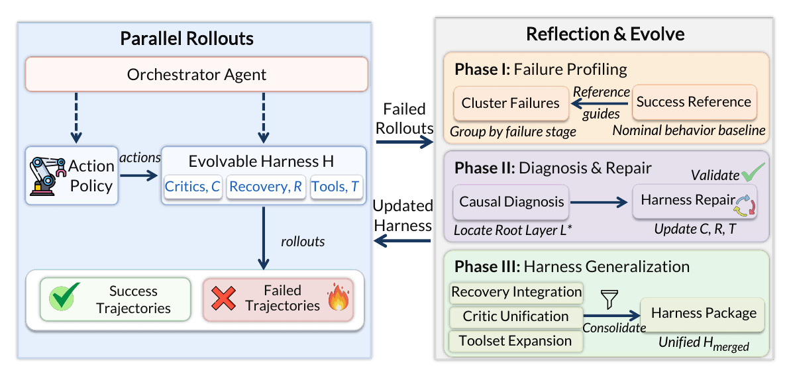

*Xin Ding et al., Zetta ζ: An Efficient Closed-Loop Embodied Harness for Self-Evolving Physical Intelligence. Core method figure from the official paper/project. [Figure source](https://air-embodied-brain.github.io/zetta/).*

Improves runtime critics and recovery skills from execution feedback around a frozen robot policy.

[Paper](https://arxiv.org/abs/2608.16590) · [Code](https://github.com/air-embodied-brain/Zetta-Embodiment)

[Project](https://air-embodied-brain.github.io/zetta/)

### SHAPER: Self-Evolving Embodied Agents via Skill-Harness Evolution

**First release:** 2026-08-11

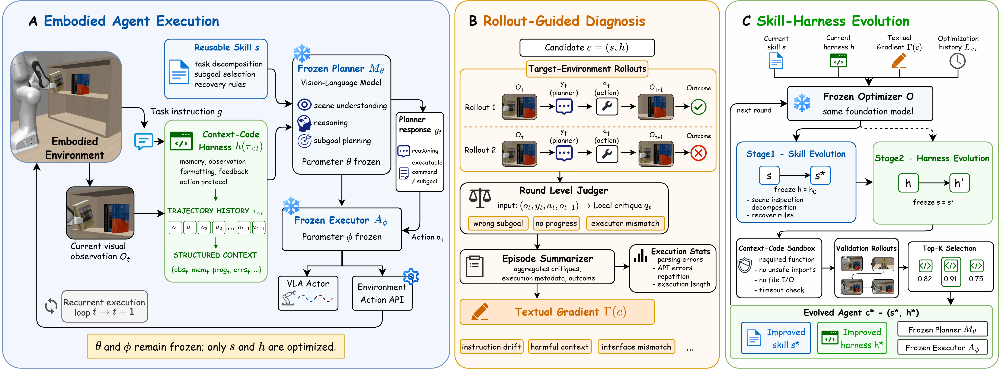

*Peidong Wang et al., SHAPER: Self-Evolving Embodied Agents via Skill-Harness Evolution. Core method figure from the official paper/project. [Figure source](https://arxiv.org/html/2608.11350v1#S3.F2).*

Uses rollout diagnosis to evolve reusable skills and the agent’s context-code harness without updating model weights.

[Paper](https://arxiv.org/abs/2608.11350)

### ASPIRE: Agentic /Skills Discovery for Robotics

**First release:** 2026-06-30

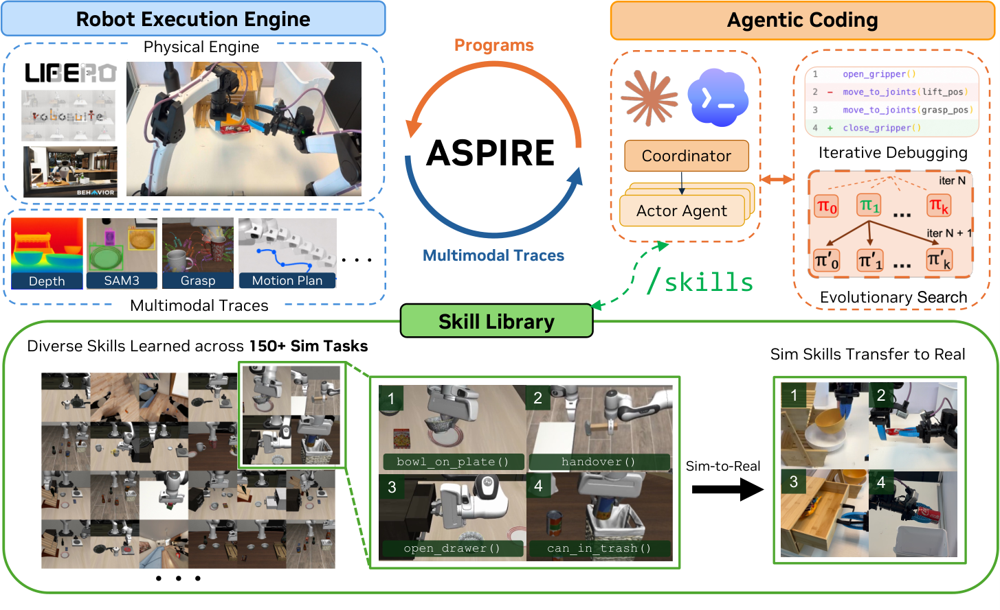

*Runyu Lu et al., ASPIRE, arXiv:2607.00272v2, Figure 1. CC BY 4.0. [Figure source](https://arxiv.org/html/2607.00272v2#S1.F1).*

Discovers reusable robot /skills by writing programs, diagnosing execution traces, repairing failures, and retaining successful strategies.

[Paper](https://arxiv.org/abs/2607.00272) · [Code](https://github.com/NVlabs/ASPIRE)

[Project](https://research.nvidia.com/labs/gear/aspire/)

### ENPIRE: Agentic Robot Policy Self-Improvement in the Real World

**First release:** 2026-06-18

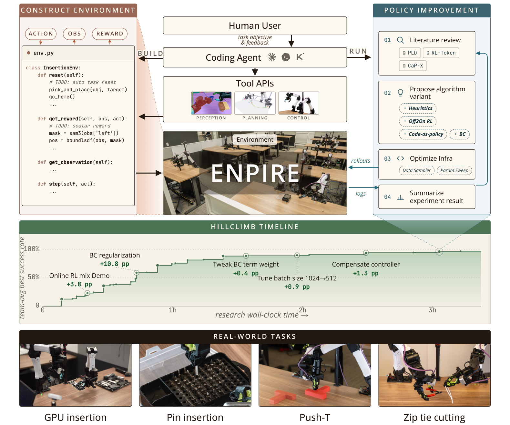

*Wenli Xiao et al., ENPIRE, arXiv:2606.19980v2, Figure 2. CC BY 4.0. [Figure source](https://arxiv.org/html/2606.19980v2#S0.F2).*

Automates real-world policy improvement through repeated robot resets, execution, outcome verification, and revisions to policy or training code.

[Paper](https://arxiv.org/abs/2606.19980) · [Code](https://github.com/NVlabs/ENPIRE)

[Project](https://research.nvidia.com/labs/gear/enpire/)

## RoboDojo · Sim agents

Updated 2026-10-28 · [Official leaderboard](https://robodojo-benchmark.com/leaderboard?bench=sim#agent)

| Rank | Agent | Score | Success rate |
| --- | --- | --- | --- |
| 1 | GO-3 Nano Preview | 61.9 | 56.42% |
| 2 | PyRUA-Lean | 55.26 | 50.35% |
| 3 | HexaShell-Preview | 53.18 | 46.85% |
| 4 | WorldScape-R²SI | 46.58 | 39.35% |
| 5 | EmbodiedEvo | 45.08 | 38.95% |

## Development

See [build and deployment instructions](docs/使用与部署.md). Edit `data/catalogue.json`, then run `python3 website/build.py` to update the README and website.

## Attribution

Based on [Awesome Robot Use Agent](https://github.com/kairunwen/Awesome-Robot-Use-Agent) by Kairun Wen. [MIT license](LICENSE). Figures retain their original licenses; see [credits](assets/ATTRIBUTION.md).

<!-- Generated by website/build.py from data/catalogue.json. -->
