# Awesome Robot RSI

Recent papers on robot recursive self-improvement.

[Website](https://Bailey-24.github.io/awesome-robot-RSI/) · [Contributing](CONTRIBUTING.md)

## Papers

### Training Reasoning Models in Simulation to Natively Use Real Robots

**First release:** 2026-11-13

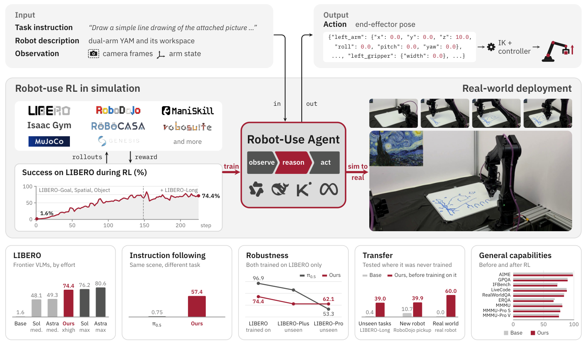

*Jiaming Tang et al., PEAR technical report, Figure 1. [Figure source](https://arxiv.org/html/2611.18562v1#S0.F1).*

Uses simulated robot-task success to update a reasoning model through reinforcement learning, retaining improved control in its weights. Released models now include a DFlash2 draft checkpoint for the PEAR policy.

[Paper](https://arxiv.org/abs/2611.18562) · [Code](https://github.com/mit-han-lab/pear)

[Models](https://huggingface.co/collections/mit-han-lab/pear) · [Project](https://mit-han-lab.github.io/pear-blog/)

### ESI: An Embodied Self-Improvement Flywheel for LLM-VLA Agents

**First release:** 2026-11-13

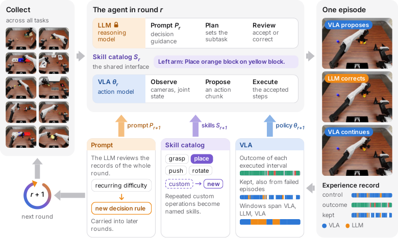

*Yundi Cai et al., ESI v2, Figure 2. [Figure source](https://arxiv.org/html/2611.18176v2#S3.F2).*

Uses LLM–VLA interaction to improve decision prompts, reusable skills, and the action policy together. Effective corrections and student actions, including useful segments of failed episodes, feed later training and collection rounds.

[Paper](https://arxiv.org/abs/2611.18176) · [Code](https://github.com/ZERITH-ZLab/ESI)

[Models](https://huggingface.co/Embodied-Self-Improvement/ESI-pi05) · [Project](https://zerith.com/blog/esi/)

### ACE-CaP-0: Real-World Code-as-Policies in the Era of Experience

**First release:** 2026-11-12

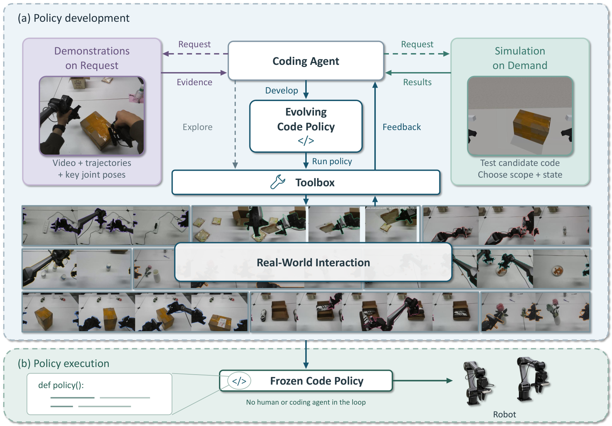

*CaP Team et al., ACE-CaP-0, Figure 5. [Figure source](https://arxiv.org/html/2611.16872v1#S3.F5).*

Refines reusable robot-control programs from physical execution feedback, requesting demonstrations and simulator trials when needed. The retained programs run with perception and control but no coding agent at deployment.

[Paper](https://arxiv.org/abs/2611.16872)

[Project](https://acerobotics2025.github.io/ACE-CaP/)

### What Can a VLA Learn from the Agent That Calls It? Task-Level Experience Distillation for Embodied Navigation

**First release:** 2026-11-12

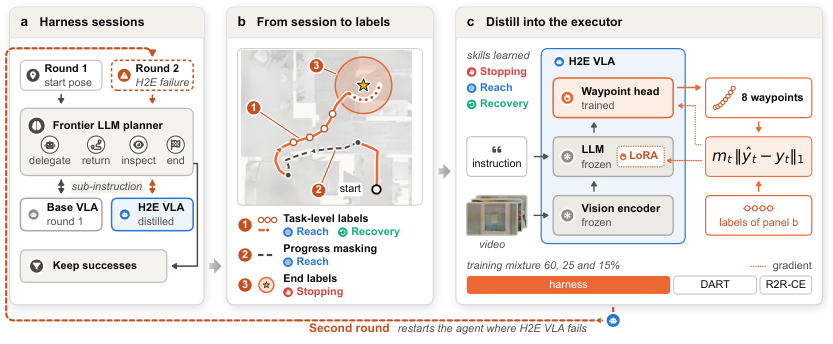

*Jinze Tao et al., H2E v3, Figure 2. [Figure source](https://arxiv.org/html/2611.16246v3#S2.F2).*

Distills successful navigation-agent sessions into a VLA through task-level relabeling and progress masking. A second round collects recovery sessions from the adapted VLA’s training-scene failures, then updates it to navigate without the planner.

[Paper](https://arxiv.org/abs/2611.16246)

### Agentic-Teacher: An Agentic Data Engine for Failure-Driven VLA Post-Training

**First release:** 2026-11-12

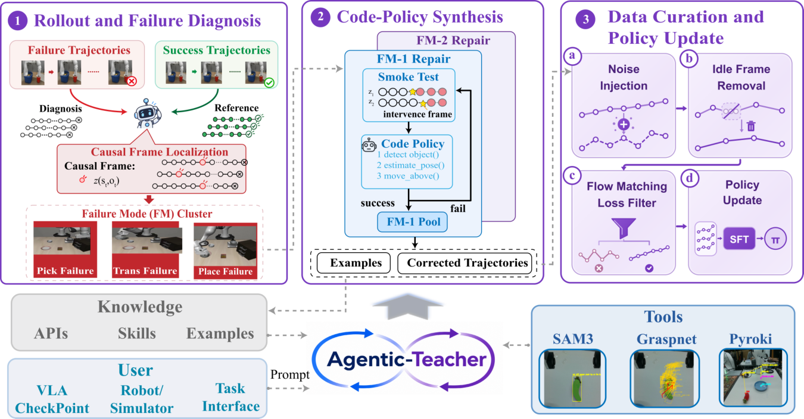

*Gongyue Teng et al., Agentic-Teacher, Figure 1. [Figure source](https://arxiv.org/html/2611.17394v1#S1.F1).*

Diagnoses VLA failures and develops reusable code policies that generate corrective demonstrations. It filters and adapts those trajectories before post-training a VLA that runs without the coding agent.

[Paper](https://arxiv.org/abs/2611.17394)

### JustRUA: A Controlled Study of GPT-6 Robot-Use Agents

**First release:** 2026-11-11

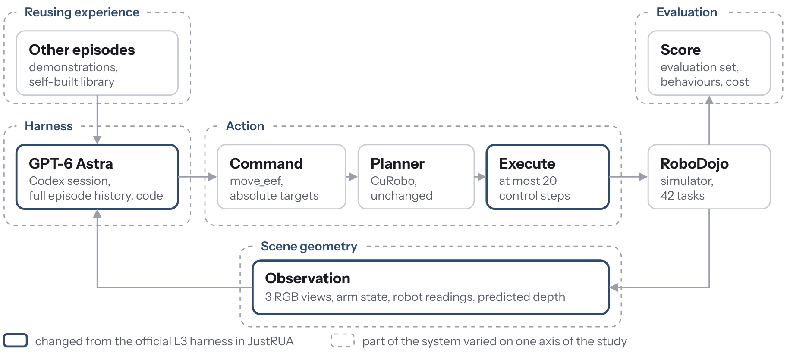

*Zefan Wang et al., JustRUA, Figure 2. [Figure source](https://arxiv.org/html/2611.16009v1#S2.F2).*

Separates the effects of robot harnesses, action interfaces, experience reuse, and scene geometry in controlled experiments. Its experience-reuse ablations test whether demonstrations and self-written skills help beyond a simpler fixed harness.

[Paper](https://arxiv.org/abs/2611.16009) · [Code](https://github.com/ZefanW/JustRUA)

[Project](https://zefanw.github.io/JustRUA)

### RoboACE: Adversarial Co-Evolution for Robot Self-Improvement

**First release:** 2026-11-09

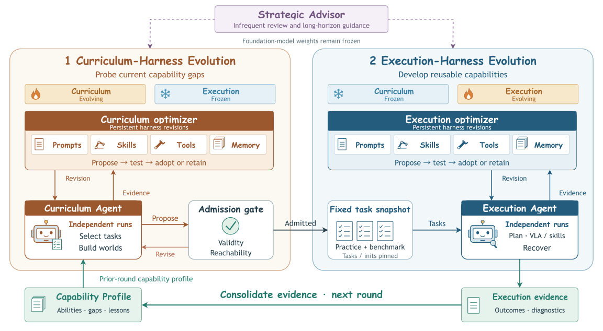

*Delin Zhao et al., RoboACE, Figure 2. [Figure source](https://arxiv.org/html/2611.13034v1#S3.F2).*

Alternates improvements to a practice-generating curriculum and an execution harness around frozen models. Fixed challenge snapshots test whether reusable execution revisions address the weaknesses found during practice.

[Paper](https://arxiv.org/abs/2611.13034)

### Flip Anything with Agentic Robotics Self-Learning

**First release:** 2026-11-09

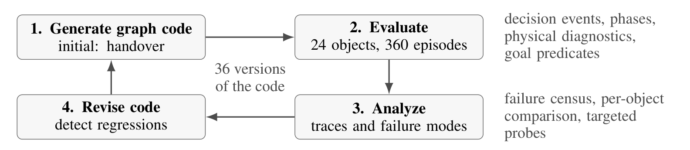

*Shuangyu Xie et al., Flip Anything, Figure 2. [Figure source](https://arxiv.org/html/2611.11941v1#S2.F2).*

Uses simulation failures to develop and revise reusable bimanual flipping strategies. The resulting graph program combines grasping, handover, pushing, and recovery, with physical-robot demonstrations.

[Paper](https://arxiv.org/abs/2611.11941)

[Project](https://berkeleyautomation.github.io/flipanything/)

### World In-Context Learning for Agentic Robot Manipulation

**First release:** 2026-11-09

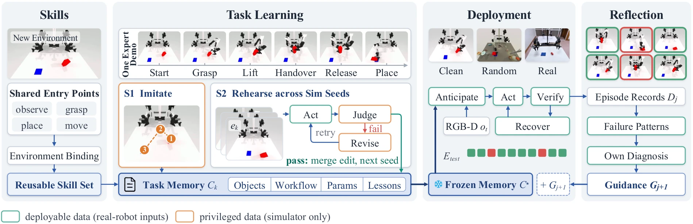

*Heng Fang et al., RoboScript, Figure 4. [Figure source](https://ArcheOne-AI.github.io/RoboScript/static/images/3-RoboScript.webp).*

Rehearses a manipulation task in simulation and stores execution lessons as reusable Task Memory. RoboScript freezes that memory for new scenes and uses later reflection to guide subsequent improvement rounds.

[Paper](https://arxiv.org/abs/2611.12885) · [Code](https://github.com/ArcheOne-AI/RoboScript)

[Project](https://ArcheOne-AI.github.io/RoboScript)

### Review the Episodes, Refine the Lessons: Simple Memory Evolution for Embodied Agents

**First release:** 2026-11-08

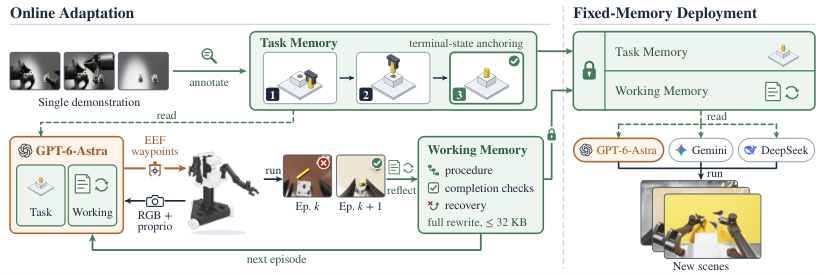

*Yifei Yao et al., SimplEvo, Figure 2. [Figure source](https://arxiv.org/html/2611.11509v1#S3.F2).*

Reviews training episodes to rewrite a bounded text memory of procedures, completion checks, and recovery lessons. The fixed memories then guide direct robot control in new scenes and can transfer to other models.

[Paper](https://arxiv.org/abs/2611.11509)

### REINS: A Self-Evolving Agent Harness for Real-Time Trajectory Planning

**First release:** 2026-11-07

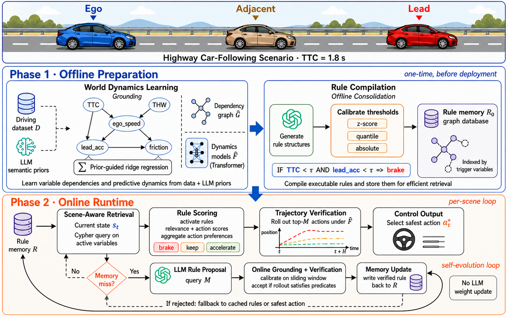

*Zhihong Cui et al., REINS, Figure 2. [Figure source](https://arxiv.org/html/2611.10748v1#S4.F2).*

Checks language-model trajectory rules against a dynamics model before storing them in an indexed memory. Familiar driving scenes reuse verified rules, while new scenes trigger further rule acquisition.

[Paper](https://arxiv.org/abs/2611.10748) · [Code](https://github.com/ZhihongCui/REINS)

### ReSkill: Selective Self-Improvement for Robot Manipulation

**First release:** 2026-11-07

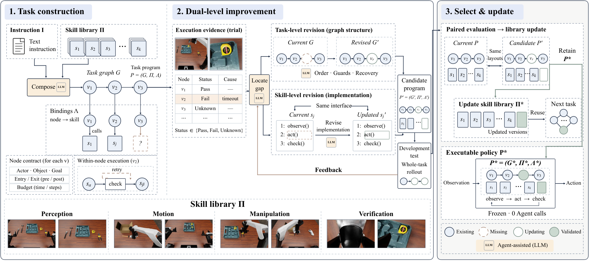

*Zheng Sun et al., ReSkill, Figure 2. [Figure source](https://arxiv.org/html/2611.10510v1#S2.F2).*

Locates manipulation failures in an object-centric task graph and selectively repairs stage logic or reusable skills. Full-task tests and paired comparisons decide which revisions to retain for agent-free execution.

[Paper](https://arxiv.org/abs/2611.10510)

### On Agentic Manipulation Policies

**First release:** 2026-11-06

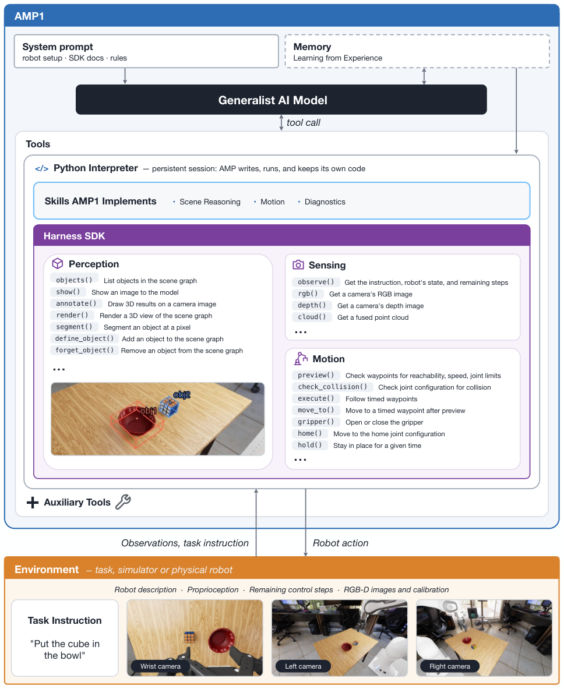

*Chen Chen et al., AMP1 v2, Figure 6. [Figure source](https://arxiv.org/html/2611.09892v2#S4.F6).*

Extends direct manipulation control with a persistent store of lessons from earlier robot episodes. The revised study tests memory formats, transfer from stronger to weaker models, and practice batch sizes.

[Paper](https://arxiv.org/abs/2611.09892) · [Code](https://github.com/apple-aiml-research/ml-amp)

[Project](https://apple-aiml-research.github.io/ml-amp/)

### Toward the Era of Agentic Embodied Intelligence

**First release:** 2026-11-06

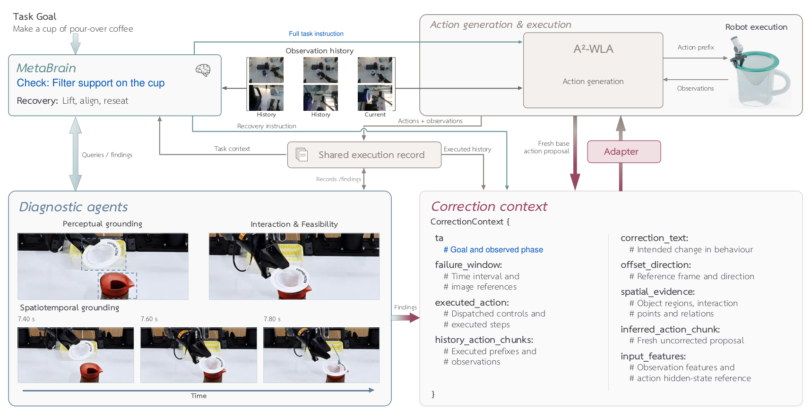

*Chao Liang et al., A2-MEAS, Figure 1. [Figure source](https://arxiv.org/html/2611.09124v1#S1.F1).*

Learns an action-policy adapter from corrective guidance, spatial evidence, and recorded execution history. The retained correction parameters let a frozen base policy use that experience when recovering from later failures.

[Paper](https://arxiv.org/abs/2611.09124)

### A Controlled Study of Models, Skills, Feedback, and Curriculum in Agentic Robotics

**First release:** 2026-11-06

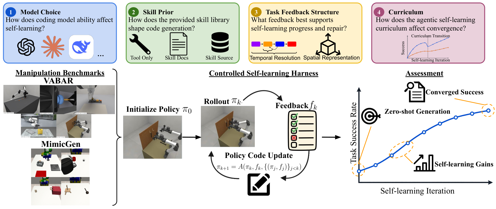

*Kaiyuan Chen et al., controlled self-learning study, Figure 2. [Figure source](https://arxiv.org/html/2611.09030v1#S1.F2).*

Tests how model capability, skill priors, feedback, and curriculum affect iterative robot-code improvement. The controlled study examines which execution evidence helps agents diagnose failures and revise policies effectively.

[Paper](https://arxiv.org/abs/2611.09030)

### Flex-RSI: Benchmarking Recursive Self-Improvement of Frontier Agents

**First release:** 2026-11-06

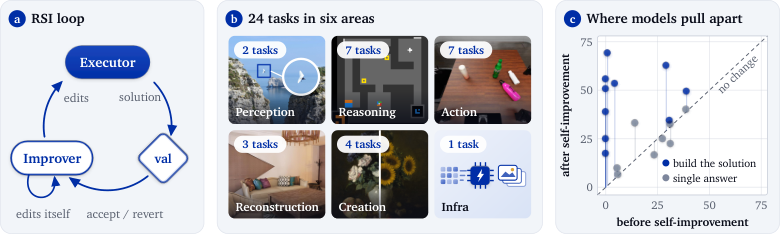

*Jingdong Zhang et al., Flex-RSI, Figure 1. [Figure source](https://arxiv.org/html/2611.08946v1#S1.F1).*

Benchmarks agents that revise both task solutions and their own harnesses under fixed budgets. Robot-action tasks use held-out validation to retain candidates and hidden tests to measure the final result.

[Paper](https://arxiv.org/abs/2611.08946) · [Code](https://github.com/flex-rsi/rsi-bench)

[Data](https://huggingface.co/datasets/Flex-RSI/RSI-Dataset) · [Project](https://flex-rsi.github.io)

### Learning the Task or Learning the Verifier? Rethinking Criteria Exposure in Embodied Self-Improvement

**First release:** 2026-11-05

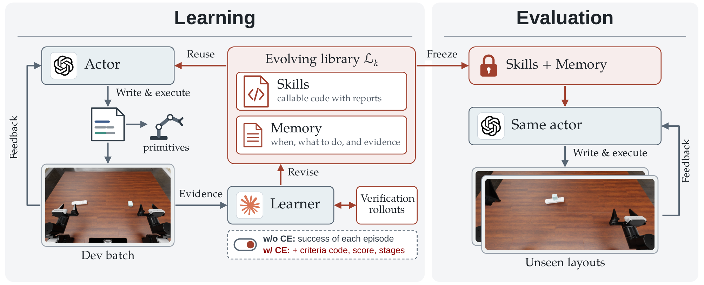

*Wenbo Huang et al., RSIJudge, Figure 2. [Figure source](https://arxiv.org/html/2611.08318v1#S3.F2).*

Tests whether exposing benchmark success criteria improves task execution or encourages verifier overfitting. It compares retained skill libraries under original and instruction-faithful criteria, including transfer to new tasks.

[Paper](https://arxiv.org/abs/2611.08318) · [Code](https://github.com/DAGroup-PKU/PyRUA-Lean/tree/RSIJudge)

[Project](https://dagroup-pku.github.io/PyRUA-Lean/RSIJudge)

### RoboARCade: Benchmarking Agentic Robot Control

**First release:** 2026-11-05

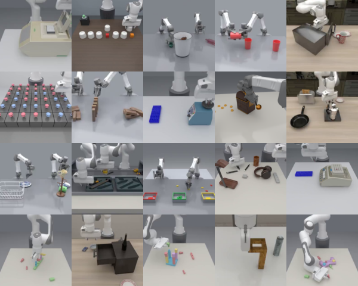

*Satvik Sharma et al., RoboARCade, Figure 1. [Figure source](https://arxiv.org/html/2611.08209v1#S1.F1).*

Evaluates long-horizon robot control and improvement from reusable demonstrations and self-revised prompts. Agents use graded rollout feedback to update a task-specific harness file for fresh sessions.

[Paper](https://arxiv.org/abs/2611.08209)

### PyRUA-DataFarm: LLM Agent as a Cost-Efficient Teleoperator for Real-Ready Robot Data

**First release:** 2026-11-03

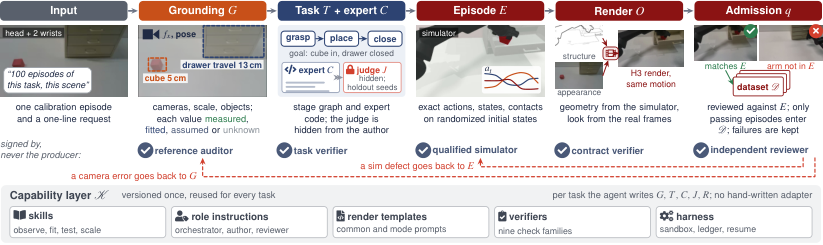

*Kewei Zhang, Juncheng Ma et al., PyRUA-DataFarm, Figure 3. CC BY 4.0. [Figure source](https://arxiv.org/html/2611.05320v1#S4.F3).*

Refines and retains robot expert programs from simulator feedback to generate training demonstrations. The quickstart now includes one real stack-cups recording with three camera views and robot states.

[Paper](https://arxiv.org/abs/2611.05320) · [Code](https://github.com/DAGroup-PKU/PyRUA-Lean/tree/DataFarm)

[Project](https://dagroup-pku.github.io/PyRUA-Lean/DataFarm/)

### TAMPAgent: Agentic Belief-Space Planning for Mobile Manipulation

**First release:** 2026-11-02

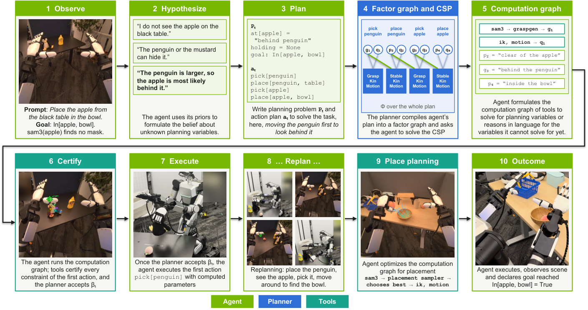

*Utkarsh A. Mishra et al., TAMPAgent, Figure 4. CC BY 4.0. [Figure source](https://arxiv.org/html/2611.03584v1#S3.F4).*

Combines an agent with belief-space task-and-motion planning. A single-task self-improvement study retains memory between attempts, allowing earlier failures to guide later solutions.

[Paper](https://arxiv.org/abs/2611.03584)

[Project](https://umishra.me/TAMPAgent/)

### RoboArchitect: Automating the Design of Robotic Agents with Persistent Memory

**First release:** 2026-10-30

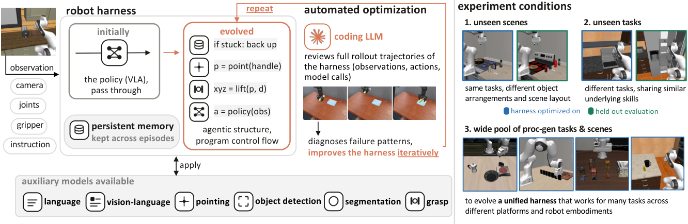

*Shengguang Wu et al., RoboArchitect, Figure 2. [Figure source](https://arxiv.org/html/2610.42141v1#S2.F2).*

A coding model studies robot rollouts and repeatedly improves the tools, control routines and persistent memory around a frozen VLA policy. The resulting harness is evaluated on unseen scenes and tasks.

[Paper](https://arxiv.org/abs/2610.42141) · [Code](https://github.com/roboarchitect-ai/RoboArchitect)

[Project](https://roboarchitect-ai.github.io/)

### REA: A Routed Embodied Agent Runtime for Asynchronous Brain-Cerebellum Control

**First release:** 2026-10-30

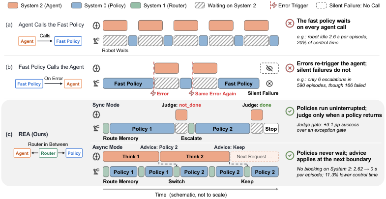

*Pengfei Zhou et al., REA, Figure 3. CC BY-NC-SA 4.0. [Figure source](https://arxiv.org/html/2610.42053v1#S1.F3).*

Retains development success statistics to route among reusable robot policies, including ASPIRE’s refined and evolved code. It evaluates this memory and a failure-judging gate on held-out episodes.

[Paper](https://arxiv.org/abs/2610.42053) · [Code](https://github.com/InfRec-Cardinal/REA)

[Project](https://mikeeeeeeeeeeeeee.github.io/REA/)

### BioAgent: Self-Directed Skill Acquisition and Capability Growth for Long-Horizon Laboratory Protocols

**First release:** 2026-10-30

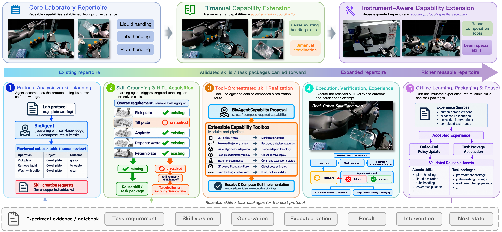

*Gaojing Zhang et al., BioAgent, Figure 2. [Figure source](https://arxiv.org/html/2610.41383v1#S2.F2).*

Uses execution records to identify missing laboratory skills, request human teaching when needed, and validate new or revised skills. Accepted experience supports offline policy updates and reusable task packages.

[Paper](https://arxiv.org/abs/2610.41383)

[Project](https://suiuko.github.io/bioagentweb/)

### TinyAstral: Transferring Self-Evolving Harnesses to Tiny Generalist Manipulation Agents

**First release:** 2026-10-30

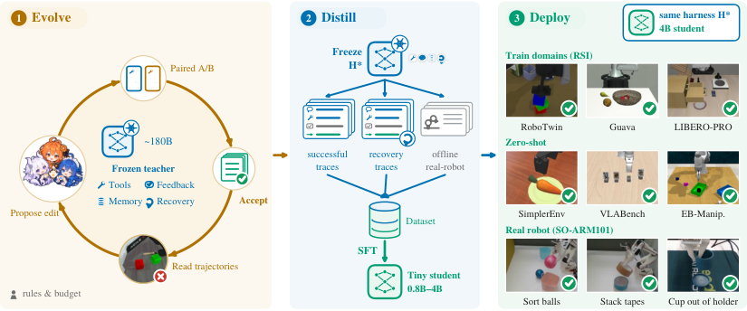

*Kehong Gong et al., TinyAstral v2, Figure 2. [Figure source](https://arxiv.org/html/2610.41216v2#S3.F2).*

Coding agents improve a frozen teacher’s tools, memory and recovery, keeping edits that pass paired statistical tests. Teacher trajectories then train small robot agents that reuse the evolved harness.

[Paper](https://arxiv.org/abs/2610.41216) · [Code](https://github.com/Garfield-kh/TinyAstral)

[Data](https://huggingface.co/datasets/kehong/TinyAstral-SFT) · [Models](https://huggingface.co/kehong/TinyAstral-weights) · [Project](https://garfield-kh.github.io/TinyAstral/)

### Gym-Anything for Robotics: Scaling physical simulations with digital agents

**First release:** 2026-10-29

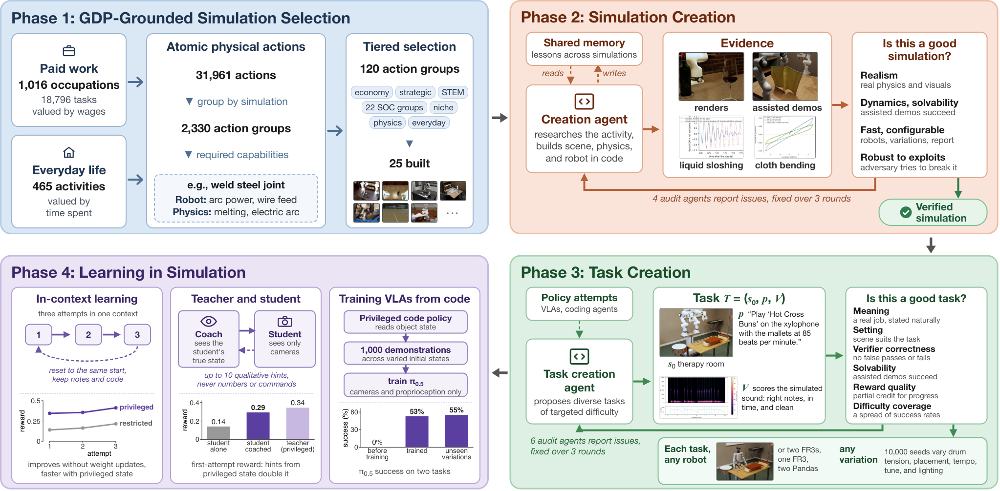

*Pranjal Aggarwal and Sean Welleck, Gym-Anything for Robotics, Figure 2. CC BY 4.0. [Figure source](https://arxiv.org/html/2610.40565v1#S1.F2).*

Builds audited robot simulations and evaluates agents that retain notes and code across attempts. The latest code release adds wrist and head views and makes robot cameras the default observations.

[Paper](https://arxiv.org/abs/2610.40565) · [Code](https://github.com/gym-anything/robotics)

[Project](https://gym-anything.github.io/robotics/)

### Ask to Evolve: A Unified Harness for Lifelong Embodied Navigation with Hybrid Action Space and Persistent Memory

**First release:** 2026-10-29

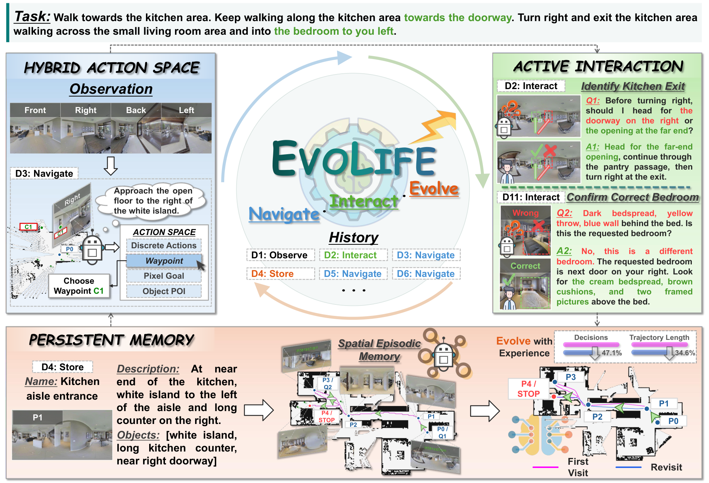

*Kai Sheng et al., EvoLife, Figure 2. [Figure source](https://arxiv.org/html/2610.39446v1#S3.F2).*

Combines navigation with active requests for guidance and persistent spatial memory. It retains place descriptions, observations and interaction history to improve later visits and tasks.

[Paper](https://arxiv.org/abs/2610.39446)

[Project](https://kai-sheng-caesar.github.io/EvoLife-Web/)

### RobotAgentBench: Towards Open-world Robot Autonomy

**First release:** 2026-10-26

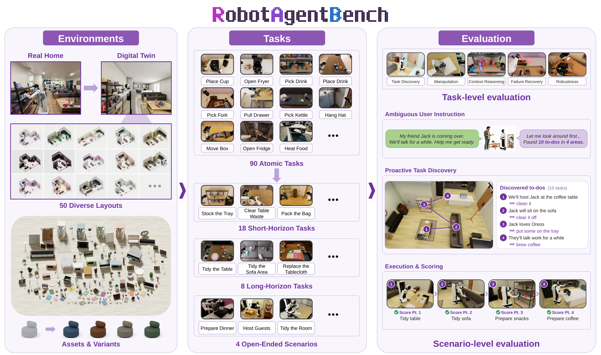

*Lingjun Mao et al., RobotAgentBench, Figure 1. CC BY 4.0. [Figure source](https://arxiv.org/html/2610.34649v1#S1.F1).*

Benchmarks household robot agents that revise and retain reusable control tools from execution feedback. Compares recursive self-improvement across task-level capabilities and open-ended home scenarios.

[Paper](https://arxiv.org/abs/2610.34649) · [Code](https://github.com/AetherLabsAI/RobotAgentBench)

[Data](https://huggingface.co/datasets/AetherLabs-AI/RobotAgentBench-TrainingData) · [Models](https://huggingface.co/AetherLabs-AI/InternVLA-A1.5-RAB) · [Project](https://aetherlabsai.github.io/RobotAgentBench/)

### R²SI: Recursive Robot Self-Improvement via a Bi-Level Agentic System with Agent–Model Co-Evolution

**Report released:** 2026-10-24

Technical report date; the project was announced on 2026-10-17.

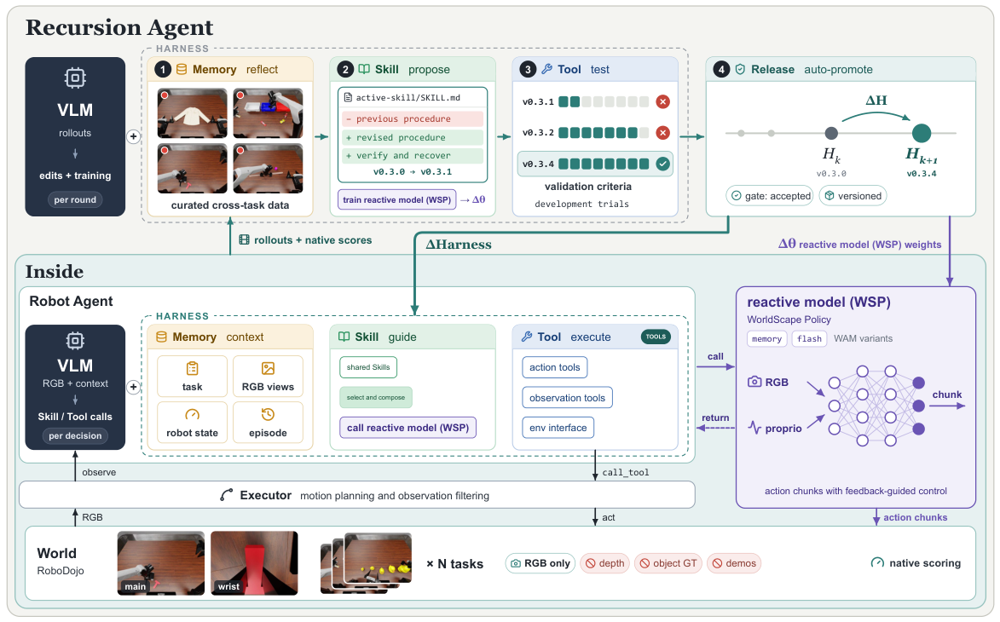

*Manifold AI Team, R²SI technical report, Figure 1. [Figure source](https://r2si.worldscape.io/report.pdf#page=2).*

Uses a Robot Agent to execute tasks and a Recursion Agent to improve reusable skills and train the reactive model from rollout feedback. [RoboDojo-Sim Agent (w/o Open) #9 · Score 45.93 · Success 37.31% (2026-11-16).](https://robodojo-benchmark.com/leaderboard?bench=sim#agent)

[Paper](https://r2si.worldscape.io/report.pdf)

[Models](https://huggingface.co/manifoldai-research/WorldScape-R2SI) · [Project](https://r2si.worldscape.io/)

### From VLM Planners to Robotic Agents: Self-Evolving Harnesses for History-Dependent Manipulation

**First release:** 2026-10-21

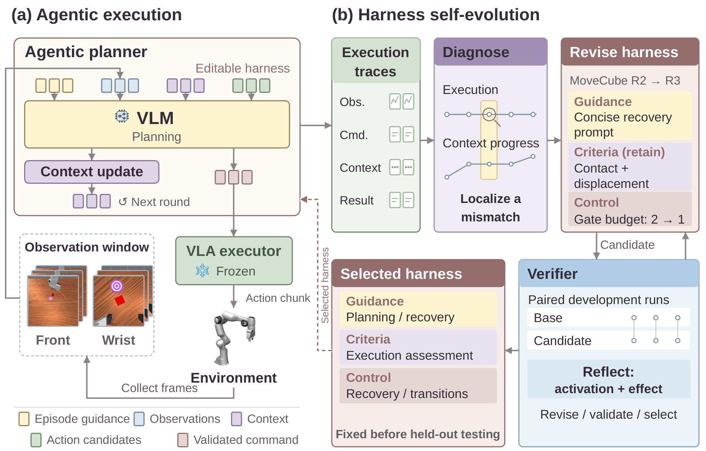

*Tingwen Du et al., From VLM Planners to Robotic Agents: Self-Evolving Harnesses for History-Dependent Manipulation. Core method figure from the official paper/project. [Figure source](https://stevenkkxs.github.io/sera-webpage/).*

Improves a planning harness from robot rollouts while keeping the low-level VLA fixed, helping the agent track task history and recover from failures.

[Paper](https://arxiv.org/abs/2610.29560) · [Code](https://github.com/StevenKKXS/SERA)

[Project](https://stevenkkxs.github.io/sera-webpage/)

### Where is Physical RSI capability from? An Observational Scaling Law of LLM-as-policy

**First release:** 2026-10-19

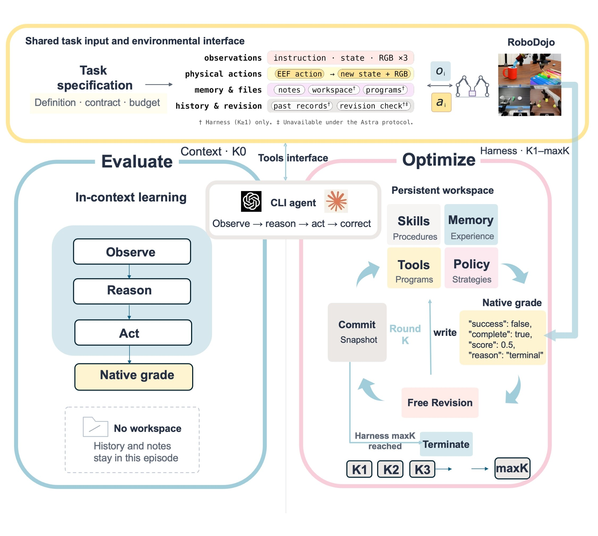

*Zekai Li et al., Where is Physical RSI capability from? An Observational Scaling Law of LLM-as-policy. Core method figure from the official paper/project. [Figure source](https://physrsi-eval.github.io/).*

Evaluates how robot agents improve across repeated attempts, measuring learning speed, interaction cost, and generalization.

[Paper](https://arxiv.org/abs/2610.26848) · [Code](https://github.com/PhysRSI-Eval/PhysRSI-Eval-code)

[Project](https://physrsi-eval.github.io/)

### HexaShell: A Universal Harness for Robot Coding Agents in Simulation and the Real World

**First release:** 2026-10-16

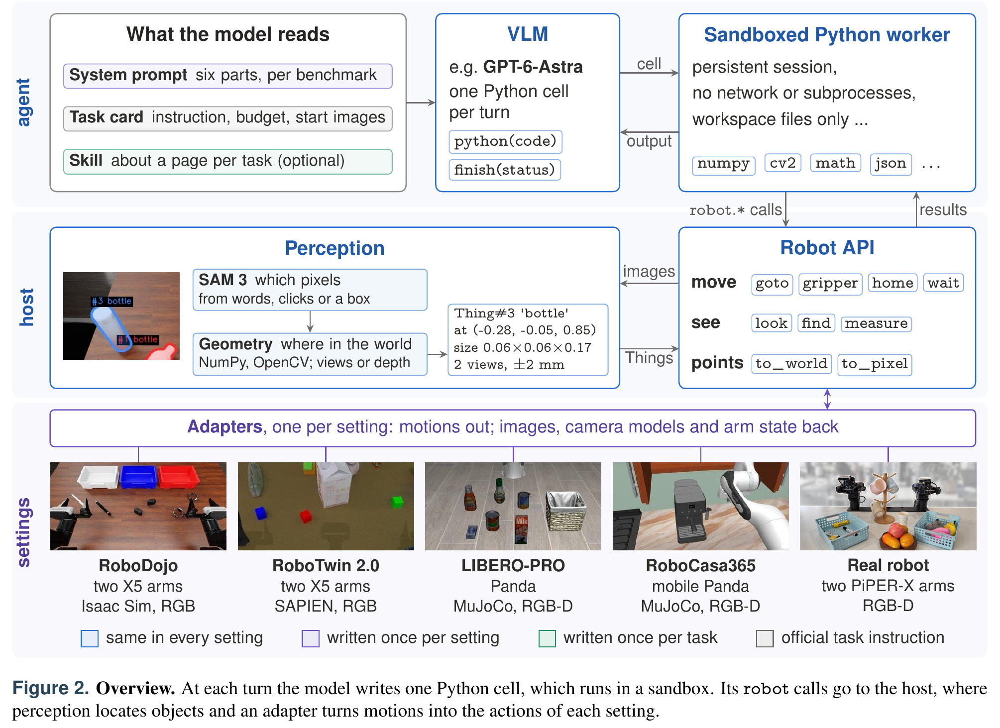

*Hongcheng Gao, Jianshu Zeng et al., HexaShell v3, Figure 2. CC BY 4.0. [Figure source](https://arxiv.org/html/2610.23479v3#S2.F2).*

Shares a 14-tool harness across simulators and real robots. An analysis agent drafts reusable task skills from earlier execution records, with human review before evaluation. [RoboDojo-Sim Agent (HexaShell-Preview; w/o Open) #7 · Score 51.98 · Success 44.75% (2026-11-16).](https://robodojo-benchmark.com/leaderboard?bench=sim#agent)

[Paper](https://arxiv.org/abs/2610.23479) · [Code](https://github.com/HexaFuture/HexaShell)

[Project](https://hexafuture.ai/blog/hexashell/)

### InstAgent: A Recursively Self-Improving Agent Operating System for Heterogeneous Robot Collaboration

**First release:** 2026-10-16

*Haoyang Luo et al., InstAgent, Figure 2. [Figure source](https://arxiv.org/html/2610.23098v1#S3.F2).*

Turns execution-time corrections into validated collaboration behavior trees that can be reused by robot teams. Shared multimodal memory preserves context for later tasks and handoffs.

[Paper](https://arxiv.org/abs/2610.23098)

[Project](https://instagent01.github.io/)

### CoEvolve: Self-Evolving Code Policies from Skills to Strategies for Humanoid Robots

**First release:** 2026-10-16

*Zicheng Liu et al., CoEvolve, Figure 2. CC BY 4.0. [Figure source](https://arxiv.org/html/2610.23288v1#S1.F2).*

Revises multi-humanoid coordination code from verified physical transitions while keeping motor skills fixed. Accepted coordination examples and experience guide later runs.

[Paper](https://arxiv.org/abs/2610.23288)

### CarryOn: A Dual-Loop Harness for Personalized and Reliable Robot Assistance

**First release:** 2026-10-15

*Zixuan Wang et al., CarryOn, Figure 2. CC BY 4.0. [Figure source](https://arxiv.org/html/2610.21453v1#S3.F2).*

Keeps revisable user and scene memory for personalized robot assistance. Reflection on failed rollouts refines reusable recovery skills around a frozen VLA policy.

[Paper](https://arxiv.org/abs/2610.21453) · [Code](https://github.com/JIA-Lab-research/CarryOn)

[Project](https://vincent2311.github.io/Projects/CarryOn/)

### Has GPT-6-Astra Achieved Embodied Intelligence?

**First release:** 2026-10-15

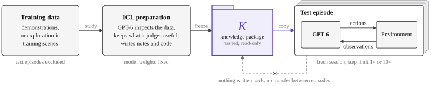

*SenseNova et al., embodied-intelligence report, Figure 2. [Figure source](https://arxiv.org/html/2610.22471v2#S2.F2).*

Studies how training-set experience becomes frozen knowledge packages for robot control across multiple benchmarks. The release adds 336 harness-ablation trajectory records and an initial SIMPLE integration. [RoboDojo-Sim Agent (w/o Open) #5 · Score 57.10 · Success 49.17% (2026-11-16).](https://robodojo-benchmark.com/leaderboard?bench=sim#agent)

[Paper](https://arxiv.org/abs/2610.22471) · [Code](https://github.com/OpenSenseNova/SenseNova-RoboRSI)

[Data](https://huggingface.co/datasets/sensenova/SenseNova-RoboRSI-Packages) · [Models](https://huggingface.co/sensenova/sensenova-roborsi-27b-preview) · [Project](https://www.sensenova.ai/has-gpt-6-astra-achieved-embodied-intelligence)

### EmbodiedEvo: Self-Evolving Coding Agent For Physical Intelligence

**First release:** 2026-10-13

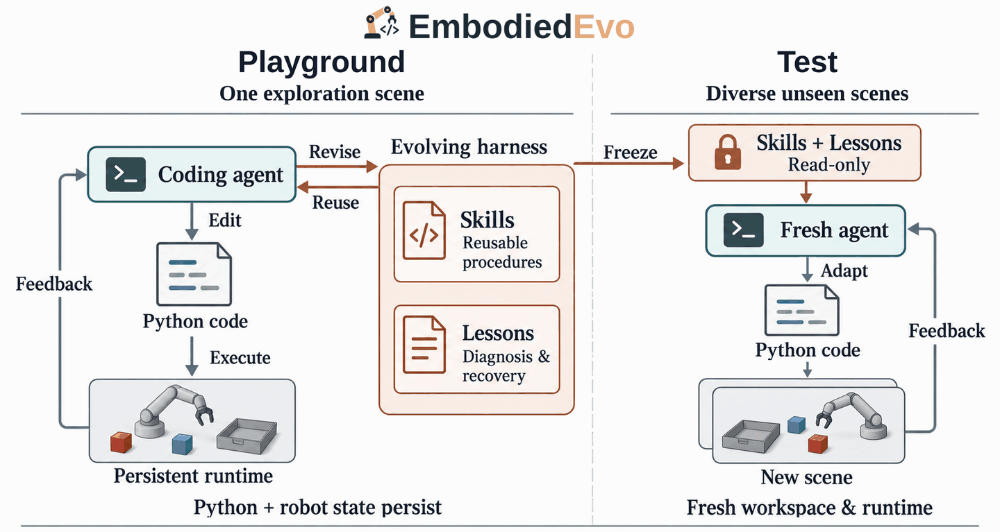

*Wenyi Li et al., EmbodiedEvo: Self-Evolving Coding Agent For Physical Intelligence. Core method figure from the official paper/project. [Figure source](https://lab.einsia.ai/embodiedevo/).*

Learns reusable code Skills and diagnostic Lessons in a practice scene, then transfers them to new scenes without weight updates. Learned artifacts for 42 RoboDojo tasks are now public. [RoboDojo-Sim Agent (w/o Open) #10 · Score 43.40 · Success 36.38% (2026-11-16).](https://robodojo-benchmark.com/leaderboard?bench=sim#agent)

[Paper](https://arxiv.org/abs/2610.18867) · [Code](https://github.com/Einsia/EmbodiedEvo)

[Project](https://lab.einsia.ai/embodiedevo/)

### SEAR: Self-Evolving Agentic Robotics

**First release:** 2026-10-13

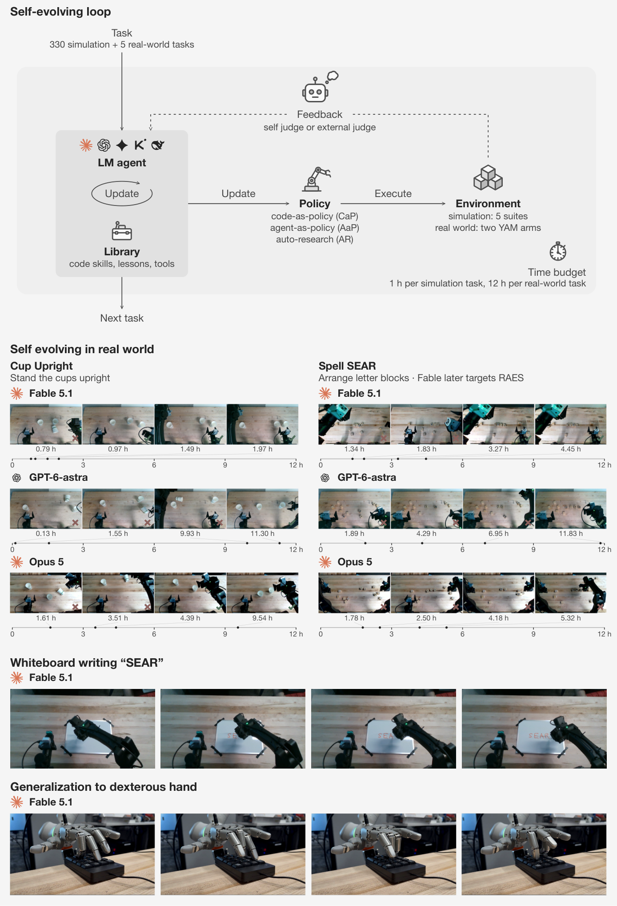

*Xinyi Wang et al., SEAR: Self-Evolving Agentic Robotics. Core method figure from the official paper/project. [Figure source](https://arxiv.org/html/2610.18792v1#S1.F2).*

Studies whether robot agents retain useful skills and memories, and whether those improvements transfer across tasks, simulators, and real robots.

[Paper](https://arxiv.org/abs/2610.18792)

[Project](https://sear.bot/)

### RSI-Nav: Data-Centric Recursive Self-Improvement for Navigation via Policy-Synchronized Language-Action Dual Bootstrapping

**First release:** 2026-10-11

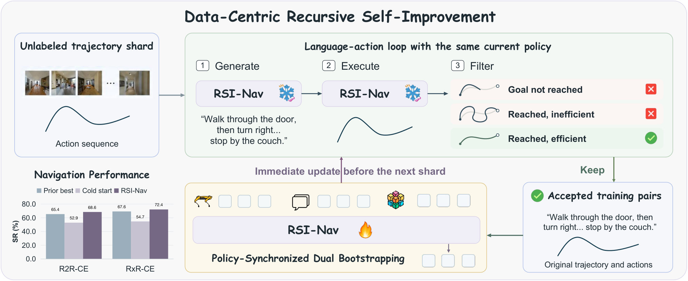

*Songze Li et al., RSI-Nav: Data-Centric Recursive Self-Improvement for Navigation via Policy-Synchronized Language-Action Dual Bootstrapping. Core method figure from the official paper/project. [Figure source](https://arxiv.org/html/2610.15782v1#S3.F3).*

Bootstraps navigation by generating instructions, filtering them through execution, and repeatedly updating the policy with the resulting data.

[Paper](https://arxiv.org/abs/2610.15782) · [Code](https://github.com/OpenGVLab/RSI-Nav)

### Embodied Turing Machines: Stateful Code for Robot Recursive Self-Improvement

**First release:** 2026-10-08

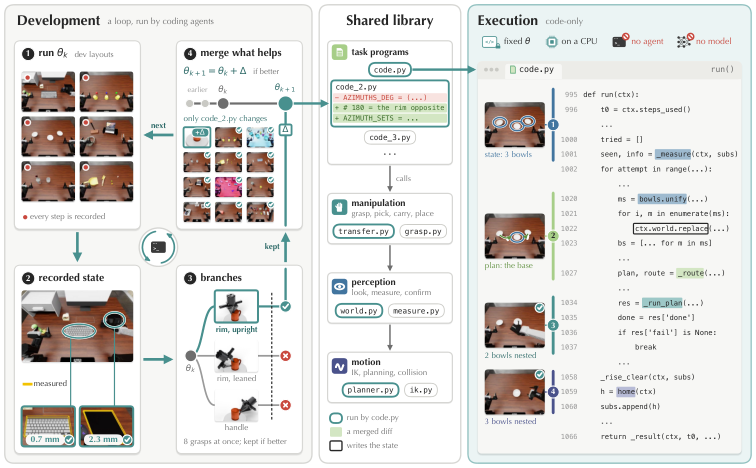

*Kairui Hu et al., Embodied Turing Machines: Stateful Code for Robot Recursive Self-Improvement. Core method figure from the official paper/project. [Figure source](https://arxiv.org/html/2610.12369v1#S3.F3).*

Builds a shared stateful code library through execution feedback, then runs robot tasks directly from code without model inference at test time.

[Paper](https://arxiv.org/abs/2610.12369)

### EmbodiedRSI: Active Continual Robot Learning Through Hypothesis-Guided Co-Evolution

**First release:** 2026-10-07

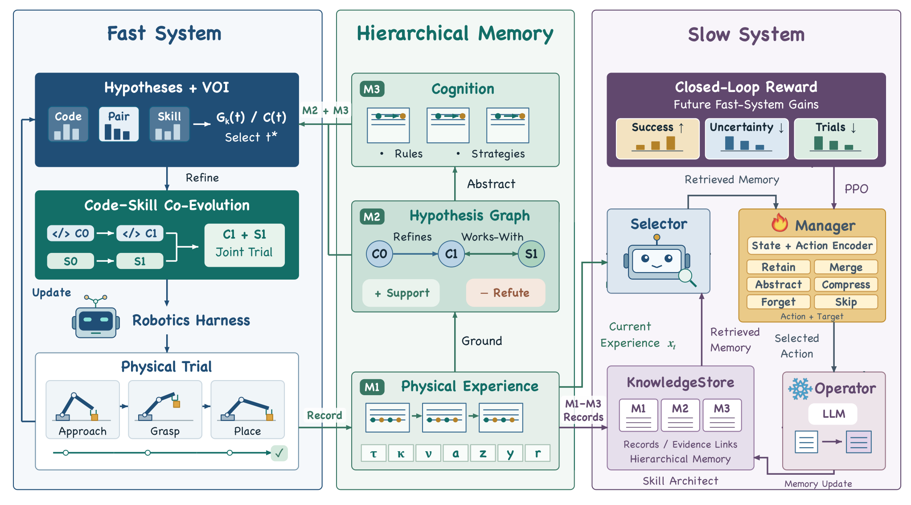

*Python Song et al., EmbodiedRSI v2, Figure 2. [Figure source](https://arxiv.org/html/2610.10498v2#S3.F2).*

Chooses robot trials to distinguish competing code and skill hypotheses, then updates reusable code and skills. A learned memory manager consolidates experience to guide later adaptation.

[Paper](https://arxiv.org/abs/2610.10498)

[Project](https://geeksongs.github.io/agentic_robotics/)

### EmbodiedSmith: Scaling Embodied Data through Recursive Self-Improvement Flywheel in Simulation

**First release:** 2026-10-06

*Yikai Qin et al., EmbodiedSmith, Figure 3. [Figure source](https://arxiv.org/html/2610.07969v1#S3.F4).*

Uses simulation checks to revise task code, robot plans and scenes in a coupled generation loop. Accepted executions become demonstrations for training robot policies.

[Paper](https://arxiv.org/abs/2610.07969)

### Co-Evolving Robot Orchestrators and Policies through Deployment

**First release:** 2026-10-06

*Xilun Zhang et al., Robo-COP, Figure 2. [Figure source](https://arxiv.org/html/2610.09228v1#S2.F2).*

Curates demonstrations from deployment, selectively fine-tunes robot skills and adopts policies only after verification. The orchestrator updates its memories as the policy changes.

[Paper](https://arxiv.org/abs/2610.09228)

### RobotUse: Allocating Computation, Context, and Decisions

**First release:** 2026-10-04

*Junhoo Lee et al., RobotUse, Figure 1. CC BY 4.0. [Figure source](https://arxiv.org/html/2610.04929v1#S1.F1).*

A between-episode refiner turns robot execution reports into a persistent playbook. Later attempts reuse and revise guidance on spatial choices, recovery and task delegation.

[Paper](https://arxiv.org/abs/2610.04929) · [Code](https://github.com/robotuse-team/RobotUse)

[Project](https://robotuse-team.github.io/)

### Reconstruct, Practice, Go Real: Guided Self-Improvement for Embodied Agents

**First release:** 2026-10-01

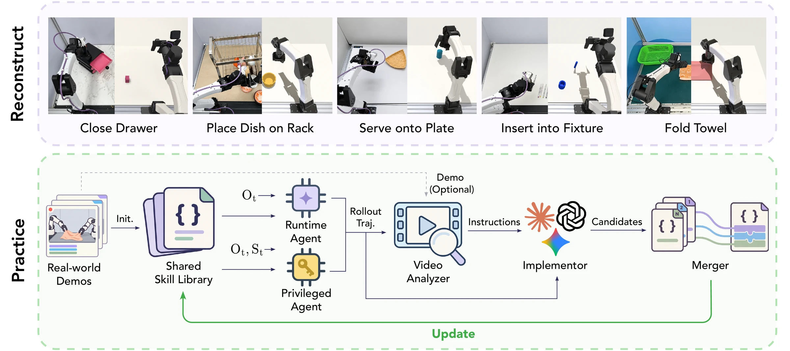

*Yen-Jen Wang et al., Reconstruct, Practice, Go Real: Guided Self-Improvement for Embodied Agents. Core method figure from the official paper/project. [Figure source](https://rpg-robot.github.io/).*

Reconstructs tasks in simulation, improves a shared skill library through practice and failure diagnosis, and transfers it to physical robots.

[Paper](https://arxiv.org/abs/2610.02204)

[Project](https://rpg-robot.github.io/)

### Fewer Tokens, Better Action: GPT-6 Astra Robot Agents with 14% Higher Success Rate but 65% Fewer Tokens

**First release:** 2026-10-01

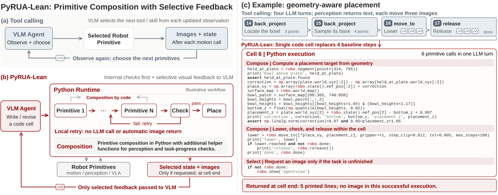

*Ruiyang Si, Jianxin Bi et al., PyRUA-Lean, Figure 2. [Figure source](https://arxiv.org/html/2610.01939v1/method_red.svg).*

Reduces repeated model calls by letting robot agents compose actions and local checks in Python. The repository also releases PyRUA-RSI’s offline-refined task programs, which run without language-model calls during evaluation. [RoboDojo-Sim Agent (w/o Open) #6 · Score 53.94 · Success 48.37% (2026-11-16).](https://robodojo-benchmark.com/leaderboard?bench=sim#agent)

[Paper](https://arxiv.org/abs/2610.01939) · [Code](https://github.com/DAGroup-PKU/PyRUA-Lean)

[Models](https://huggingface.co/DAGroup-PKU/PyRUA-Lean-Coder-v0.1-4B) · [Project](https://dagroup-pku.github.io/PyRUA-Lean/)

### DynaHarness: A Dynamic Physical Harness for Self-Evolving Robot Agents

**First release:** 2026-09-30

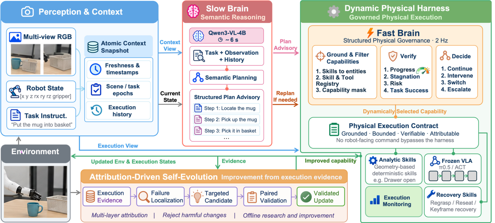

*Haoyuan Deng et al., DynaHarness, Figure 2. [Figure source](https://arxiv.org/html/2609.40306v1#S3.F2).*

Attributes execution failures to reusable robot capabilities and proposes targeted repairs. Paired regression checks decide which revisions enter the shared physical harness.

[Paper](https://arxiv.org/abs/2609.40306)

[Project](https://denghaoyuan123.github.io/Dynaharness_page/)

### ASENA: Self-evolving Agents for Embodied Navigation

**First release:** 2026-09-30

![ASENA Figure 2: ASENA connects coding agents to physical robots. The system integrates robot sensing, a persistent workspace, supervised execution, and an optional learned navigation policy. Each run is stored as an MCAP record [ 10 ] that aligns sensor an](assets/papers/asena.png)

*An-Chieh Cheng et al., ASENA, Figure 2. CC BY 4.0. [Figure source](https://arxiv.org/html/2609.39207v1#S3.F2).*

Coding agents retain notes and executable skills after inspecting simulation feedback. A shared robot harness supports navigation, interaction and supervised physical execution without changing agent weights.

[Paper](https://arxiv.org/abs/2609.39207)

[Project](https://research.nvidia.com/labs/gear/asena/)

### Make Code as Policy Great Again: Frontier Agents Write, Call, and Evolve Robot Tools

**First release:** 2026-09-30

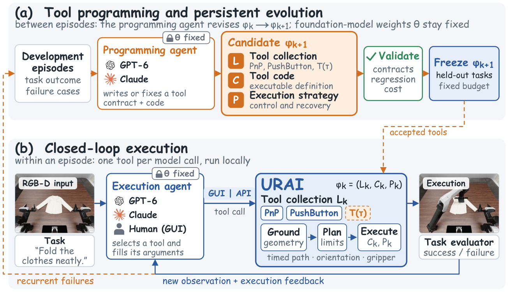

*Shijia Ge et al., URAI, Figure 2. CC BY 4.0. [Figure source](https://arxiv.org/html/2609.39018v1#S3.F2).*

A programming agent uses execution feedback and human guidance to refine reusable robot tools. A separate execution agent selects tools, with validated revisions kept across episodes.

[Paper](https://arxiv.org/abs/2609.39018)

### RoboHarn-Evo: Evolving Hierarchical Physical Knowledge for Self-Improving Robotic Manipulation

**First release:** 2026-09-29

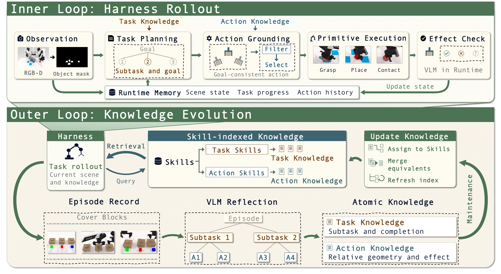

*Shifeng Bao et al., RoboHarn-Evo: Evolving Hierarchical Physical Knowledge for Self-Improving Robotic Manipulation. Core method figure from the official paper/project. [Figure source](https://ruckbreasoning.github.io/RoboHarn-Evo/).*

Uses execution feedback to revise hierarchical task and action knowledge while keeping the base model and executor fixed.

[Paper](https://arxiv.org/abs/2609.37583) · [Code](https://github.com/RUCKBReasoning/RoboHarn-Evo)

[Project](https://ruckbreasoning.github.io/RoboHarn-Evo/)

### DexAgent: An Agentic Human2Sim2Robot Framework for Dexterous Manipulation with Self-Evolving Tool Library

**First release:** 2026-09-28

*Youhui Wang et al., DexAgent, Figure 2. CC BY 4.0. [Figure source](https://arxiv.org/html/2609.35318v1#S3.F2).*

Converts human videos into simulated robot demonstrations using property-specific checks to repair skills and verifiers. Newly developed tools remain in a library for later videos.

[Paper](https://arxiv.org/abs/2609.35318)

[Project](https://dexagent123.github.io/)

### Recursive Harness Distillation across Agents for Robot Manipulation

**First release:** 2026-09-27

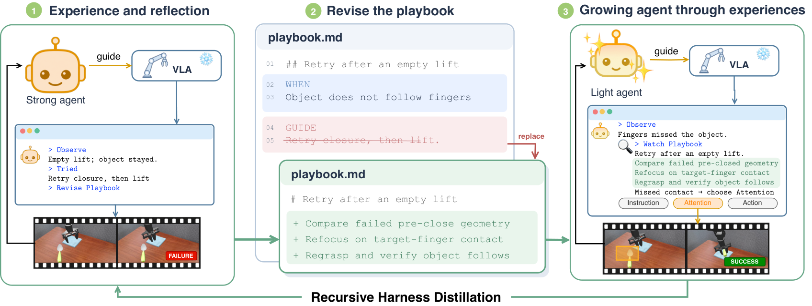

*Seungyeon Kim et al., Recursive Harness Distillation across Agents for Robot Manipulation. Core method figure from the official paper/project. [Figure source](https://seungyeon.me/RHD/).*

Distills a strong agent’s robot experience into a playbook for a lighter agent, then refines the playbook using the recipient’s feedback.

[Paper](https://arxiv.org/abs/2609.33378)

[Project](https://seungyeon.me/RHD)

### RoboFoundry: System-as-Policy Evolution for Self-Learning Embodied Agents

**First release:** 2026-09-26

*Jingsong Liang et al., RoboFoundry, Figure 2. [Figure source](https://arxiv.org/html/2609.32862v1#S2.F2).*

Turns execution traces into tested changes to context, memory and hierarchical skills. Recurring repairs are promoted into a shared system for later tasks and robot embodiments.

[Paper](https://arxiv.org/abs/2609.32862)

[Project](https://jingsongliang.com/robofoundry/)

### HarnessPAI: An Evolving Harness for Physical AI

**First release:** 2026-09-24

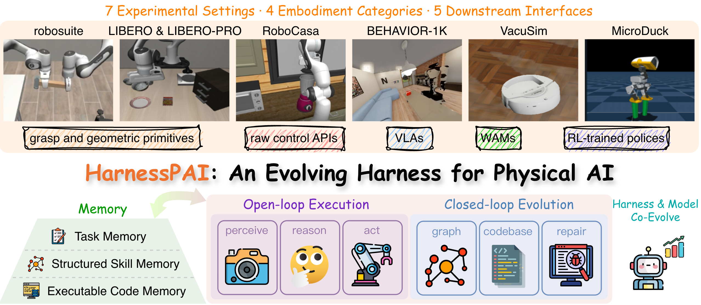

*Xin Wang et al., HarnessPAI, Figure 1. [Figure source](https://arxiv.org/html/2609.29166v1#S0.F1).*

Executes fixed robot programs within each rollout, then uses failure feedback to revise code between rollouts. Validated programs and repair skills are kept for reuse and demonstration generation.

[Paper](https://arxiv.org/abs/2609.29166) · [Code](https://github.com/Darwin-Agent/HarnessPAI)

[Project](https://darwin-agent.github.io/HarnessPAI/)

### RACaP: Agentic Reasoning, Acting, and Coding as Policies for Evolvable Robot Learning

**First release:** 2026-09-24

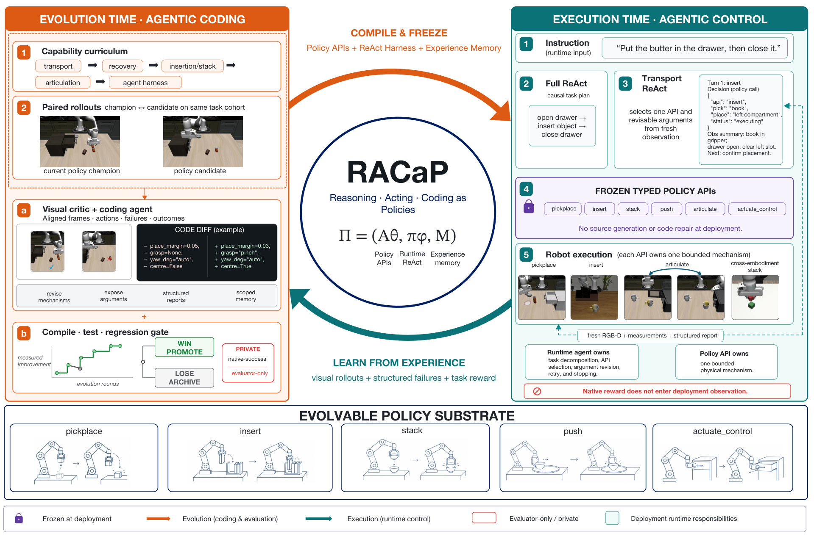

*Zexi Li et al., RACaP, Figure 1. [Figure source](https://arxiv.org/html/2609.29394v1#S1.F1).*

Evolves typed robot APIs, a ReAct harness and experience memory through a capability curriculum and paired candidate tests. Deployment reuses frozen APIs while visual reasoning adapts their arguments.

[Paper](https://arxiv.org/abs/2609.29394) · [Code](https://github.com/Robo-Harness/racap)

### Zetta ζ: An Efficient Closed-Loop Embodied Harness for Self-Evolving Physical Intelligence

**First release:** 2026-08-17

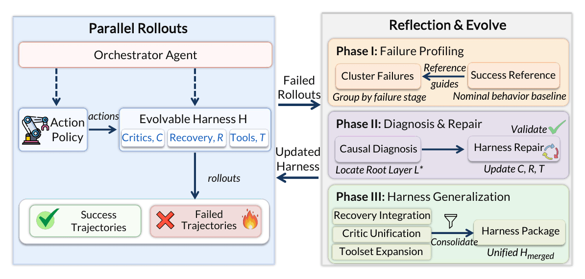

*Xin Ding et al., Zetta ζ: An Efficient Closed-Loop Embodied Harness for Self-Evolving Physical Intelligence. Core method figure from the official paper/project. [Figure source](https://air-embodied-brain.github.io/zetta/).*

Improves runtime critics and recovery skills from execution feedback around a frozen robot policy.

[Paper](https://arxiv.org/abs/2608.16590) · [Code](https://github.com/air-embodied-brain/Zetta-Embodiment)

[Project](https://air-embodied-brain.github.io/zetta/)

### SHAPER: Self-Evolving Embodied Agents via Skill-Harness Evolution

**First release:** 2026-08-11

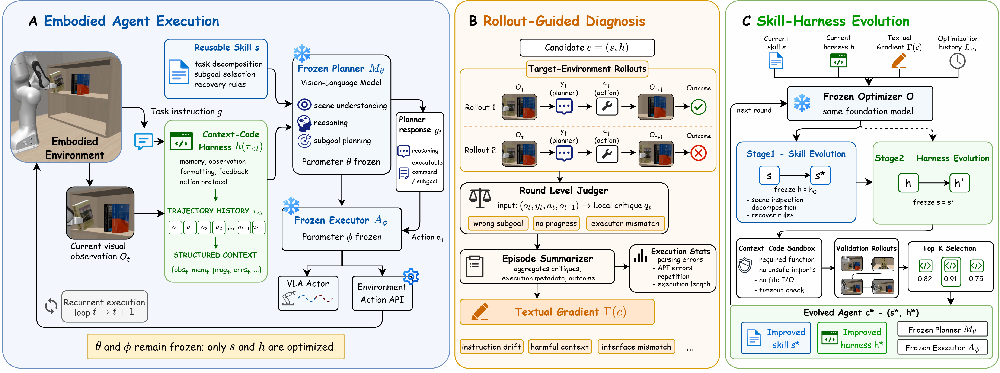

*Peidong Wang et al., SHAPER: Self-Evolving Embodied Agents via Skill-Harness Evolution. Core method figure from the official paper/project. [Figure source](https://arxiv.org/html/2608.11350v1#S3.F2).*

Uses rollout diagnosis to evolve reusable skills and the agent’s context-code harness without updating model weights.

[Paper](https://arxiv.org/abs/2608.11350)

### PhyAgentOS: A Self-Evolving Operating System for Embodied Agents with Decoupled Cognitive Planning and Physical Execution

**First release:** 2026-07-18

*Yang Liu et al., PhyAgentOS, Figure 3. [Figure source](https://arxiv.org/html/2607.16636v1#S3.F3).*

Turns verified robot sessions into reusable skills and corrective lessons. File-based state and memory connect planning, supervised execution and later task attempts.

[Paper](https://arxiv.org/abs/2607.16636) · [Code](https://github.com/PhyAgentOS/PhyAgentOS-core)

[Project](https://phy-agent-os.net)

### ASPIRE: Agentic /Skills Discovery for Robotics

**First release:** 2026-06-30

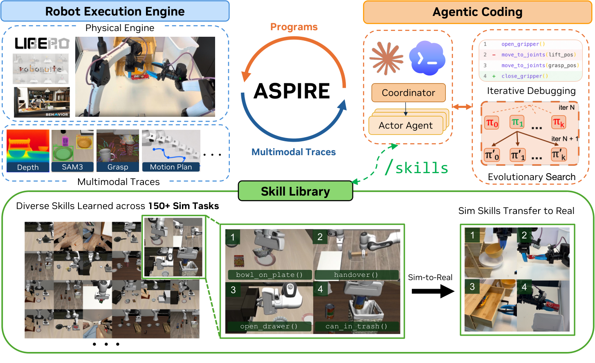

*Runyu Lu et al., ASPIRE, arXiv:2607.00272v2, Figure 1. CC BY 4.0. [Figure source](https://arxiv.org/html/2607.00272v2#S1.F1).*

Discovers reusable robot /skills by writing programs, diagnosing execution traces, repairing failures, and retaining successful strategies.

[Paper](https://arxiv.org/abs/2607.00272) · [Code](https://github.com/NVlabs/ASPIRE)

[Project](https://research.nvidia.com/labs/gear/aspire/)

### ENPIRE: Agentic Robot Policy Self-Improvement in the Real World

**First release:** 2026-06-18

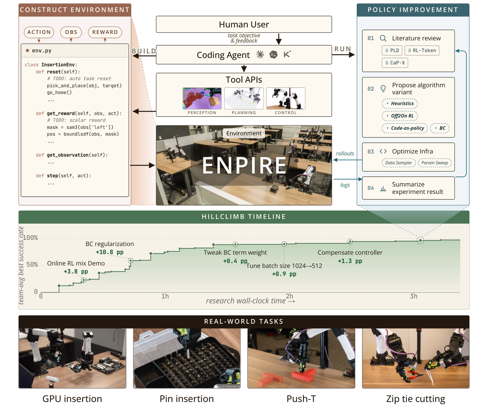

*Wenli Xiao et al., ENPIRE, arXiv:2606.19980v2, Figure 2. CC BY 4.0. [Figure source](https://arxiv.org/html/2606.19980v2#S0.F2).*

Automates real-world policy improvement through repeated robot resets, execution, outcome verification, and revisions to policy or training code.

[Paper](https://arxiv.org/abs/2606.19980) · [Code](https://github.com/NVlabs/ENPIRE)

[Project](https://research.nvidia.com/labs/gear/enpire/)

## Development

See [build and deployment instructions](docs/使用与部署.md). Edit `data/catalogue.json`, then run `python3 website/build.py` to update the README and website.

## Attribution

Based on [Awesome Robot Use Agent](https://github.com/kairunwen/Awesome-Robot-Use-Agent) by Kairun Wen. [MIT license](LICENSE). Figures retain their original licenses; see [credits](assets/ATTRIBUTION.md).

<!-- Generated by website/build.py from data/catalogue.json. -->
