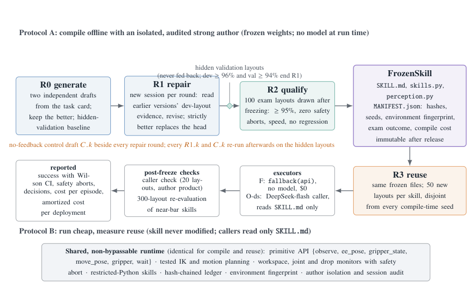

# Awesome Robot RSI

Recent research on robot recursive self-improvement: policies, reusable skills, code, and agent harnesses that improve through execution feedback.

**Updated:** 2026-10-28 · **18 selected works** · [Website](https://Bailey-24.github.io/awesome-robot-RSI/) · [Contributing](CONTRIBUTING.md)

## Scope

Robot recursive self-improvement (RSI): a robot or its agent uses execution feedback to revise a policy, reusable skill, code, memory, or harness, then evaluates the revision. Benchmark and evaluation work is labelled separately.

The main collection prioritizes **first releases on or after 2026-07-01**. ENPIRE and ASPIRE are explicitly included as foundational exceptions. First-release dates are kept separate from later revisions. Reported results are not independent reproductions.

Every entry includes a credited method or overview figure, a concise summary, the improvement loop, and available resources. Missing Data and Models links are omitted.

## RoboDojo · Sim agent snapshot

Checked **2026-10-28**. Ranked by **Average Score (descending); Success Rate (%) shown separately**; success rate is a separate metric. [Official leaderboard](https://robodojo-benchmark.com/leaderboard?bench=sim#agent).

| Rank | Agent | Score | Success rate | Type |
| --- | --- | --- | --- | --- |
| 1 | GO-3 Nano Preview | 61.9 | 56.42% | Agent + WAM |
| 2 | PyRUA-Lean | 55.26 | 50.35% | Agent |
| 3 | HexaShell-Preview | 53.18 | 46.85% | Agent |
| 4 | WorldScape-R²SI | 46.58 | 39.35% | Agent + WAM |
| 5 | EmbodiedEvo | 45.08 | 38.95% | Agent |

RoboDojo-Sim Agent track; 42 simulation tasks in Generalization, Precision, Long-Horizon, Memory, and Open. Includes Agent, Agent + WAM and Agent + VLA entries. Score is a progress metric, not success rate; Generalization averages standard and random layouts. The site sorts Average Score descending, then Success Rate descending, then model name; display ranks are ordinal. Top five have no ties.

A leaderboard entry does not by itself establish RSI. This snapshot is not updated automatically; consult the official board for the current ranking.

- **GO-3 Nano Preview:** Leaderboard-only preview in this collection; no primary paper, code, or recursive-improvement claim verified. Added by the official news log on 2026-10-27.
- **PyRUA-Lean:** Efficient code-execution framework; keep as an adjacent robot-agent baseline, not evidence of recursive self-improvement. Paper/project experiments differ from this verified leaderboard snapshot.
- **HexaShell-Preview:** Between episodes, an optimizer repairs reusable tools from failures; frozen tools are used for evaluation. Release is partial, not the complete server/evolution infrastructure.
- **WorldScape-R²SI:** A Robot Agent acts through Skills; a Recursion Agent revises Skills and can train a reactive model. The project page preserves its historical October 17 #1 claim; current rank is #4.
- **EmbodiedEvo:** Turns Playground interaction into persistent Skills and Lessons, frozen before test scenes. Original paper metrics 44.48/37.82 differ from current official 45.08/38.95.

## Policy & skill learning

### R²SI: Recursive Robot Self-Improvement via a Bi-Level Agentic System with Agent–Model Co-Evolution

**Report released:** 2026-10-24

**Date note:** Technical report date; the project was announced on 2026-10-17.


*Manifold AI Team, R²SI technical report, Figure 1. [Figure source](https://r2si.worldscape.io/report.pdf#page=2).*

A two-layer agent system improves both reusable robot Skills and the reactive action model. The inner Robot Agent acts from RGB observations, proprioception and memory; the outer Recursion Agent reviews rollouts, revises Skills, selects execution records for model training, and promotes updates after tests. WorldScape-R²SI combines persistent harness revisions with model-weight updates.

**Improvement loop:** Execute → review rollouts → revise Skills and/or train the reactive model → test against acceptance criteria → release a versioned update → execute again.

**Setting:** RoboDojo-Sim manipulation; Agent + World Action Model.

**Evidence:** The technical report and official RoboDojo-Sim snapshot report Average Score 46.58 and Success Rate 39.35%. The project page retains its historical October 17 rank-one claim; the October 28 snapshot ranks the system fourth. Reported simulations and selected case studies do not establish broad real-world performance.

[Paper](https://r2si.worldscape.io/report.pdf)

[Models](https://huggingface.co/manifoldai-research/WorldScape-R2SI) · [Project](https://r2si.worldscape.io/)

### Compile Once, Run Cheap: Frozen, Portable Skills for Embodied Agents, and What Recursive Self-Improvement Adds

**First release:** 2026-10-18



*Figure 1 © the Skill-RSI authors; extracted from page 2 of the official PDF (figure region only). [Figure source](https://arxiv.org/pdf/2610.25114#page=2).*

Uses a strong model to write, diagnose, repair, and qualify robot skills offline, then reuses the frozen files as code alone or through a cheaper caller.

**Improvement loop:** Draft code skills → run development layouts → diagnose and repair from evidence → qualify on newly sampled layouts → freeze and reuse with code-only or cheaper callers.

**Setting:** Simulation · RoboTwin 2.0 manipulation

**Evidence:** Skill-RSI separates compilation from deployment and validates after freezing on hidden layouts. Seven released skills cover four of seven RoboTwin 2.0 tasks; all experiments are in simulation. Code is Apache-2.0; data, ledgers, and frozen skills are CC BY 4.0. Raw model I/O and evidence images are not included, and no direct-control baseline was run.

[Paper](https://arxiv.org/abs/2610.25114) · [Code](https://github.com/Orillusion/embodied-skill-rsi)

[Data](https://github.com/Orillusion/embodied-skill-rsi/tree/main/data)

### Reconstruct, Practice, Go Real: Guided Self-Improvement for Embodied Agents

**First release:** 2026-10-01


*Yen-Jen Wang et al., Reconstruct, Practice, Go Real: Guided Self-Improvement for Embodied Agents. Core method figure from the official paper/project. [Figure source](https://rpg-robot.github.io/).*

RPG develops reusable robot skills and a shared system prompt through dataset-guided simulation practice, using failure diagnosis and cross-task validation before physical deployment.

**Improvement loop:** Reconstruct dataset tasks in simulation → practice and inspect execution video with privileged diagnostics → implement and cross-validate skill revisions → merge a shared library → freeze for physical deployment.

**Setting:** Simulation and real robot · 22 simulated tasks; 30 physical trials across three tasks

**Evidence:** Model weights stay fixed; privileged simulator state and dataset videos support offline diagnosis. Evaluated on 22 simulated tasks and 30 physical trials across three tasks after calibration and hardware adaptation. Code is listed as forthcoming.

[Paper](https://arxiv.org/abs/2610.02204)

[Project](https://rpg-robot.github.io/)

### ASPIRE: Agentic /Skills Discovery for Robotics

**First release:** 2026-06-30 · **Revised:** 2026-10-20 · **Foundation — requested exception to the July cutoff**


*Runyu Lu et al., ASPIRE, arXiv:2607.00272v2, Figure 1. CC BY 4.0. [Figure source](https://arxiv.org/html/2607.00272v2#S1.F1).*

A coding agent writes robot programs, inspects multimodal execution traces, diagnoses failures, validates repairs and saves successful strategies as reusable /skills. Evolutionary search explores diverse candidate programs, while a growing skill library carries experience to new tasks. Improvement accumulates as executable programs and in-context skill knowledge rather than updates to the underlying language model.

**Improvement loop:** Execute candidate programs → diagnose multimodal traces → repair and validate code → save reusable /skills for subsequent tasks.

**Setting:** LIBERO-Pro, Robosuite and BEHAVIOR-1K simulation; selected physical-robot transfer experiments.

**Evidence:** Evaluated on LIBERO-Pro, Robosuite and BEHAVIOR-1K, with simulation-to-real skill transfer and online physical-robot examples including Rubik’s Cube manipulation. The project distinguishes debug seeds from held-out evaluation seeds. Behavior is bounded by a predefined perception, planning and control API. The real-world setup still requires success detection, resets, monitoring and calibration; reported performance depends on the language model, task subset and evaluation protocol.

[Paper](https://arxiv.org/abs/2607.00272) · [Code](https://github.com/NVlabs/ASPIRE)

[Project](https://research.nvidia.com/labs/gear/aspire/)

### ENPIRE: Agentic Robot Policy Self-Improvement in the Real World

**First release:** 2026-06-18 · **Revised:** 2026-09-20 · **Foundation — requested exception to the July cutoff**


*Wenli Xiao et al., ENPIRE, arXiv:2606.19980v2, Figure 2. CC BY 4.0. [Figure source](https://arxiv.org/html/2606.19980v2#S0.F2).*

Turns physical robot research into a repeatable reset–execute–verify–refine loop. Coding agents inspect rollout logs, propose changes to heuristics or learning code, and evaluate those changes on one robot or a fleet. Its four modules connect environment setup, policy improvement, rollout and experiment evolution; the open implementation supports code-as-policy and neural policy training.

**Improvement loop:** Reset and execute → verify outcomes and inspect logs → revise policy code or training → evaluate the revision and retain improvements.

**Setting:** Physical robot manipulation and RoboCasa simulation.

**Evidence:** Real-world manipulation includes Push-T, pin insertion, GPU insertion and zip-tie tasks, with additional RoboCasa simulation. The project page defines its headline 99% result as pass@8 with adaptive in-context retries; it should not be presented as 99% single-attempt success. Requires calibrated stations and task-specific reset and outcome-verification functions. Robot-fleet speedups consume additional tokens and depend on resource utilization.

[Paper](https://arxiv.org/abs/2606.19980) · [Code](https://github.com/NVlabs/ENPIRE)

[Project](https://research.nvidia.com/labs/gear/enpire/)

## Code & harness evolution

### From VLM Planners to Robotic Agents: Self-Evolving Harnesses for History-Dependent Manipulation

**First release:** 2026-10-21


*Tingwen Du et al., From VLM Planners to Robotic Agents: Self-Evolving Harnesses for History-Dependent Manipulation. Core method figure from the official paper/project. [Figure source](https://stevenkkxs.github.io/sera-webpage/).*

Wraps a fixed VLA executor with an editable planning harness that manages task history and selects improvements from rollout feedback.

**Improvement loop:** Execute with a frozen VLA → summarize task history and failures → edit planning harness → verify and select → freeze for held-out evaluation.

**Setting:** Simulation · RoboMME history-dependent manipulation

**Evidence:** The selected harness is frozen before held-out testing, while episode context continues to update. The paper reports 51.38% RoboMME success with autonomous selection versus 44.38% without self-evolution. The Apache-2.0 implementation uses an external Codex planner and the released RoboMME grounded-subgoal π0.5 checkpoint; model weights and benchmark assets are downloaded separately. Evaluation is in simulation.

[Paper](https://arxiv.org/abs/2610.29560) · [Code](https://github.com/StevenKKXS/SERA)

[Project](https://stevenkkxs.github.io/sera-webpage/)

### HexaShell: A Thin Harness for Exploring the Limits of VLM Agents as Robot Coding Agents

**First release:** 2026-10-16


*Hongcheng Gao, Alex Zhou et al., HexaShell, Figure 4; official HexaFuture project page. [Figure source](https://hexafuture.ai/blog/hexashell/assets/fig04-harness-20261020.webp).*

An unchanged coding agent operates a robot through a thin command-line harness and calibrated RGB observations. Between episodes, a second agent diagnoses failures, repairs executable tools, and tests the revisions. The foundation model stays fixed while the reusable tool library improves; evaluation then freezes the tools.

**Improvement loop:** Run a robot episode → diagnose failures → write or repair a reusable tool → test on development layouts → freeze tools for evaluation.

**Setting:** RoboDojo-Sim: 42 manipulation tasks; two physical-arm demonstrations.

**Evidence:** Official RoboDojo evaluation covers 42 tasks and 2,100 episodes: Average Score 53.18 and Success Rate 46.85%. The release provides frozen tools, recipes, results and interface contracts, while server, executors, agent container and evolution infrastructure are not all released. Two physical-arm demonstrations are narrower evidence than the simulation benchmark.

[Paper](https://arxiv.org/abs/2610.23479) · [Code](https://github.com/HexaFuture/HexaShell)

[Project](https://hexafuture.ai/blog/hexashell/)

### EmbodiedEvo: Self-Evolving Coding Agent For Physical Intelligence

**First release:** 2026-10-13


*Wenyi Li et al., EmbodiedEvo: Self-Evolving Coding Agent For Physical Intelligence. Core method figure from the official paper/project. [Figure source](https://lab.einsia.ai/embodiedevo/).*

Turns interaction feedback in a Playground scene into reusable code Skills and diagnostic Lessons, then freezes them for fresh agents to solve unseen scenes without model-weight updates.

**Improvement loop:** Practice in a Playground scene → diagnose physical feedback → revise persistent Skills and Lessons → freeze experience → fresh agents solve unseen Test scenes.

**Setting:** Simulation · RoboDojo-Sim

**Evidence:** Evaluated on RoboDojo-Sim with a Playground/Test protocol. The paper reports an average score of 44.48 and 37.82% success; these results are author-reported and have not been independently reproduced here.

[Paper](https://arxiv.org/abs/2610.18867) · [Code](https://github.com/Einsia/EmbodiedEvo)

[Project](https://lab.einsia.ai/embodiedevo/)

### Embodied Turing Machines: Stateful Code for Robot Recursive Self-Improvement

**First release:** 2026-10-08


*Kairui Hu et al., Embodied Turing Machines: Stateful Code for Robot Recursive Self-Improvement. Core method figure from the official paper/project. [Figure source](https://arxiv.org/html/2610.12369v1#S3.F3).*

Introduces Code-Only-as-Policy (COAP), a shared stateful code library that improves from execution feedback and controls robot tasks without model inference at test time.

**Improvement loop:** Execute stateful code on development layouts → inspect measured state and failures → coding agents propose and test library diffs → retain improvements → run fixed code policies without model inference.

**Setting:** Simulation · 42 RoboDojo bimanual tasks

**Evidence:** Reports 70.24% success across RoboDojo’s 42 bimanual tasks. The authors identify accurate state measurement and robust code logic as key limitations.

[Paper](https://arxiv.org/abs/2610.12369)

### EmbodiedRSI: Active Continual Robot Learning Through Hypothesis-Guided Co-Evolution

**First release:** 2026-10-07


*Python Song et al. (2026), EMBODIEDRSI method overview. [Figure source](https://geeksongs.github.io/agentic_robotics/).*

Selects informative robot trials to test competing hypotheses and jointly refine executable code, reusable skills, and memory around frozen robot foundation models.

**Improvement loop:** Maintain competing code/skill hypotheses → select informative physical experiments by value of information → co-evolve code and skills → consolidate reward-grounded hierarchical memory → improve subsequent adaptation.

**Setting:** Simulation and real robot · RoboCasa365, LIBERO-Pro; SO-101 arm with frozen SmolVLA

**Evidence:** The official project reports 77.0% overall RoboCasa365 success, 86.8% LIBERO-Pro, and 71.3% across five real-world tasks. The harness transfers from simulation; SmolVLA was first fine-tuned with 50 demonstrations per physical task and then frozen. Glasses-grasp success decreases from 60.0% to 56.7%.

[Paper](https://arxiv.org/abs/2610.10498)

[Project](https://geeksongs.github.io/agentic_robotics/)

### RoboHarn-Evo: Evolving Hierarchical Physical Knowledge for Self-Improving Robotic Manipulation

**First release:** 2026-09-29


*Shifeng Bao et al., RoboHarn-Evo: Evolving Hierarchical Physical Knowledge for Self-Improving Robotic Manipulation. Core method figure from the official paper/project. [Figure source](https://ruckbreasoning.github.io/RoboHarn-Evo/).*

Improves robot manipulation by retrieving and evolving hierarchical task and action knowledge from execution feedback while keeping the base model and executor fixed.

**Improvement loop:** Retrieve task/action knowledge → ground and execute skills → verify effects → reflect on recorded episodes → correct and consolidate hierarchical knowledge for future tasks.

**Setting:** Simulation and real robot · RMBench, frozen-knowledge RoboDojo transfer, physical manipulation

**Evidence:** Inner-loop retrieval grounds reusable knowledge in the current scene; outer-loop updates correct and consolidate it across episodes. Evaluated on RMBench, frozen-knowledge transfer to RoboDojo, and real-robot tasks. Public code includes the harness, knowledge maintenance, and benchmark adapters; simulator assets, model checkpoints, and services are configured separately.

[Paper](https://arxiv.org/abs/2609.37583) · [Code](https://github.com/RUCKBReasoning/RoboHarn-Evo)

[Project](https://ruckbreasoning.github.io/RoboHarn-Evo/)

### Recursive Harness Distillation across Agents for Robot Manipulation

**First release:** 2026-09-27


*Seungyeon Kim et al., Recursive Harness Distillation across Agents for Robot Manipulation. Core method figure from the official paper/project. [Figure source](https://seungyeon.me/RHD/).*

Distills a strong agent’s robot-intervention experience into a playbook for a lighter agent, then refines that guidance from the recipient’s execution feedback.

**Improvement loop:** A strong agent intervenes around a frozen VLA → distill experience into a playbook → lighter agent executes → use recipient feedback to revise the shared playbook.

**Setting:** Simulation and real robot · SimplerEnv Bridge and Franka Panda

**Evidence:** Agents edit instructions, attention, and proposed actions around a frozen VLA. Evaluated in SimplerEnv Bridge and on a physical Franka Panda without updating model parameters.

[Paper](https://arxiv.org/abs/2609.33378)

[Project](https://seungyeon.me/RHD)

### Zetta ζ: An Efficient Closed-Loop Embodied Harness for Self-Evolving Physical Intelligence

**First release:** 2026-08-17


*Xin Ding et al., Zetta ζ: An Efficient Closed-Loop Embodied Harness for Self-Evolving Physical Intelligence. Core method figure from the official paper/project. [Figure source](https://air-embodied-brain.github.io/zetta/).*

Keeps the base policy frozen while developing runtime critics and recovery skills through execution, diagnosis, and gated updates.

**Improvement loop:** Execute a frozen policy with runtime critics → diagnose failure → evolve critic and recovery skills → gate updates → reuse validated interventions.

**Setting:** Simulation · LIBERO-Pro Goal and LIBERO-10 perturbations; 18 RoboCasa Atomic-Seen tasks

**Evidence:** With the base VLA frozen, the official project reports 90.8% mean success on LIBERO-Pro Goal (T/S) and 93.6% across 18 RoboCasa Atomic-Seen tasks under its rollout budget. These are simulation results; Goal success is distinct from the lower LIBERO-10 results, and task/rollout budgets should be matched in comparisons.

[Paper](https://arxiv.org/abs/2608.16590) · [Code](https://github.com/air-embodied-brain/Zetta-Embodiment)

[Project](https://air-embodied-brain.github.io/zetta/)

### SHAPER: Self-Evolving Embodied Agents via Skill-Harness Evolution

**First release:** 2026-08-11


*Peidong Wang et al., SHAPER: Self-Evolving Embodied Agents via Skill-Harness Evolution. Core method figure from the official paper/project. [Figure source](https://arxiv.org/html/2608.11350v1#S3.F2).*

Keeps model parameters frozen while evolving reusable skills and a context-code harness from target-environment rollouts.

**Improvement loop:** Collect target-environment rollouts → diagnose round/episode failures into textual gradients → evolve skills then context-code harness → sandbox validation and top-K selection.

**Setting:** Simulation · VLABench and ESI-Bench

**Evidence:** Evaluated on VLABench and ESI-Bench with different action interfaces. Improves external skills and execution context without model training.

[Paper](https://arxiv.org/abs/2608.11350)

## Evaluation

### Where is Physical RSI capability from? An Observational Scaling Law of LLM-as-policy

**First release:** 2026-10-19


*Zekai Li et al., Where is Physical RSI capability from? An Observational Scaling Law of LLM-as-policy. Core method figure from the official paper/project. [Figure source](https://physrsi-eval.github.io/).*

Introduces PhysRSI-Eval to study how public model capabilities and early robot feedback relate to the speed, extent, and generalization of self-improvement.

**Improvement loop:** Evaluate the initial agent → repeated budgeted attempts with persistent code/tools/memory → revise between attempts → measure gain timing, best scores, cost and generalization.

**Setting:** Simulation · 18 RoboDojo dual-arm tasks; released generalization code covers four tasks

**Evidence:** The paper evaluates 18 RoboDojo manipulation tasks with fixed model weights and interaction budgets; agents revise persistent code, tools and memory for up to 17 improvement rounds. The released generalization-study implementation covers four tasks rather than the paper’s full 18. Best-score metrics include partial progress and differ from native binary success; capability associations are observational.

[Paper](https://arxiv.org/abs/2610.26848) · [Code](https://github.com/PhysRSI-Eval/PhysRSI-Eval-code)

[Project](https://physrsi-eval.github.io/)

### SEAR: Self-Evolving Agentic Robotics

**First release:** 2026-10-13


*Xinyi Wang et al., SEAR: Self-Evolving Agentic Robotics. Core method figure from the official paper/project. [Figure source](https://arxiv.org/html/2610.18792v1#S1.F2).*

Studies whether robot agents retain useful skills and memories beyond extra retries, and whether improvements transfer across tasks, simulators, and real robots.

**Improvement loop:** Run code-as-policy, agent-as-policy or VLA auto-research within fixed budgets → collect independent feedback → retain a cross-task library → evaluate against restarts and no-library controls on held-out conditions.

**Setting:** Simulation and real robot · 330 simulated tasks and five physical tasks

**Evidence:** SEAR compares code-as-policy, live agent-as-policy, and VLA auto-research modes across seven frontier models, 330 simulated tasks, and five physical tasks. Budget-matched controls distinguish retained experience from restarts, privileged information, and luck. The paper and project are public; the repository contains announcement assets and an unchecked code-release milestone, not an executable implementation.

[Paper](https://arxiv.org/abs/2610.18792)

[Project](https://sear.bot/)

## Navigation

### RSI-Nav: Data-Centric Recursive Self-Improvement for Navigation via Policy-Synchronized Language-Action Dual Bootstrapping

**First release:** 2026-10-11


*Songze Li et al., RSI-Nav: Data-Centric Recursive Self-Improvement for Navigation via Policy-Synchronized Language-Action Dual Bootstrapping. Core method figure from the official paper/project. [Figure source](https://arxiv.org/html/2610.15782v1#S3.F3).*

Unifies navigation, instruction generation, and spatial understanding in one VLM; filters generated instructions by navigation success and path efficiency, then updates the policy after each trajectory shard with spatial-data replay.

**Improvement loop:** Generate language for unlabeled trajectories with the current policy → execute and filter by goal completion and efficiency → jointly update navigation and instruction generation with spatial replay → repeat per trajectory shard.

**Setting:** Simulation and real robot · R2R-CE, RxR-CE, DEEP Robotics M20

**Evidence:** Built on Qwen3.5-9B and evaluated on R2R-CE, RxR-CE, and a DEEP Robotics M20 robot. Released code covers training, trajectory conversion, recursive self-improvement, and R2R-CE evaluation; weights and datasets are prepared separately.

[Paper](https://arxiv.org/abs/2610.15782) · [Code](https://github.com/OpenGVLab/RSI-Nav)

## Leaderboard reference

### Fewer Tokens, Better Action: GPT-6 Astra Robot Agents with 14% Higher Success Rate but 65% Fewer Tokens

**First release:** 2026-10-01


*Ruiyang Si, Jianxin Bi et al., PyRUA-Lean, Figure 2. [Figure source](https://arxiv.org/html/2610.01939v1/method_red.svg).*

An interactive Python runtime lets a robot agent compose primitives, run local checks and retries, and return only requested observations. This reduces repeated model calls and redundant images. Its later open 4B Coder model is trained with GRPO, but efficient online execution and post-training alone do not demonstrate a persistent recursive self-improvement process.

**Improvement loop:** No persistent self-improvement loop established; efficient online code execution is an adjacent baseline.

**Setting:** Simulation: LIBERO-PRO, RoboTwin 2.0, RoboCasa365 and RoboDojo.

**Evidence:** The matched-planner study covers 700 simulated instances across LIBERO-PRO, RoboTwin 2.0 and RoboCasa365. Token reductions apply to instances solved by both agents. The current verified RoboDojo snapshot is 55.26 Average Score and 50.35% Success Rate; the paper/project 58.20/51.62% experiment is a separate result and should not replace it.

[Paper](https://arxiv.org/abs/2610.01939) · [Code](https://github.com/DAGroup-PKU/PyRUA-Lean)

[Models](https://huggingface.co/DAGroup-PKU/PyRUA-Lean-Coder-v0.1-4B) · [Project](https://dagroup-pku.github.io/PyRUA-Lean/)

## Build and preview

Python 3.11+ is sufficient; the builder has no third-party dependencies. From the repository root:

```sh
python3 website/build.py
python3 -m unittest discover -s tests
python3 -m http.server 8000 --directory website/dist
```

Open http://localhost:8000. Edit `data/catalogue.json`, then rebuild; it generates both this README and `website/dist/`. Commit the catalogue, figures and generated README. `website/dist/` is ignored.

For GitHub Pages, select **Settings → Pages → Source → GitHub Actions**. Pushes to `main` build, validate and deploy the static site through `.github/workflows/pages.yml`. No API keys or analytics account are required.

## Attribution and licensing

Initial discovery and curation build on [Awesome Robot Use Agent](https://github.com/kairunwen/Awesome-Robot-Use-Agent) by Kairun Wen (MIT). The focused selection and summaries are maintained here; original copyright notices are retained in [LICENSE](LICENSE).

Paper figures are reproduced with links and author credits for research reference. They remain the property of their respective authors and are not relicensed under this repository’s MIT code license. See [figure attribution](assets/ATTRIBUTION.md).

<!-- Generated by website/build.py from data/catalogue.json. Edit the catalogue, not this file. -->
